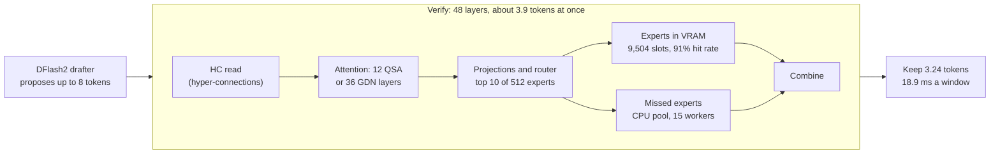

<p align="center">
  
</p>

<p align="center">
  <a href="https://github.com/KhaledElzarw/Strata/releases/tag/v0.1.58-sm86.1"></a>
  
  
  
  <a href="LICENSE"></a>
</p>

<p align="center">
  <b>A fork of <a href="https://github.com/Niko1221/Strata">Strata</a> that makes one RTX 3090 decode faster without changing a single output bit.</b><br>
  <sub>Every change is an opt-in switch. With none set, the engine runs upstream's code paths. Bit-identical means identical to upstream, which ships two defaults that change output slightly: see the <a href="#disclaimer">disclaimer</a>.</sub>
</p>

<p align="center">
  <a href="#results">Results</a> · <a href="#quick-start"><b>Quick start</b></a> · <a href="#the-switches">The switches</a> ·
  <a href="#quality-bit-identical">Quality</a> · <a href="#reproduce-it">Reproduce it</a> · <a href="#how-far-it-can-go">How far it can go</a>
</p>

<table align="center">
  <tr>
    <td align="center"><h2>162–169</h2><sub>tok/s median decode per round<br>57 recorded agent turns, 262K context</sub></td>
    <td align="center"><h2>+17.3%</h2><sub>decode, compounded from four<br>paired A/Bs over the tuned config</sub></td>
    <td align="center"><h2>1,363 / 1,363</h2><sub>forced-decode positions with<br>identical FP32 log-probabilities</sub></td>
    <td align="center"><h2>3,122</h2><sub>tok/s cold prompt throughput<br>at 64K tokens (21 s)</sub></td>
  </tr>
</table>

## What this is

[Strata](https://github.com/Niko1221/Strata) runs large mixture-of-experts models on one consumer GPU by keeping the
most-used experts in VRAM and computing the rest on the CPU. This fork tunes its decode path for **one RTX 3090
(Ampere, sm_86)** running **Qwen3.8-Flash-Next** (the abliterated GSQ-RCO IQ3_XXS GGUF) at its full **262,144-token
context**, and ships the lab that measured every change.

- **Exact.** Each kernel computes the same operations in the same order as the one it replaces. The checks compare
  hashes and FP32 log-probabilities, not "close enough".
- **Measured on real work.** A step was adopted only after a paired, interleaved A/B on 57 recorded agent turns, with
  a fresh engine per arm, a gain of at least 2% and a 95% confidence interval that excludes zero.
- **Opt-in.** New behaviour sits behind `STRATA_*` switches, off by default, so the fork stays a drop-in for upstream.

Forked from upstream `146df3c46` (v0.1.58, 2026-11-07). Not affiliated with or endorsed by the upstream project. For
everything this fork does not change (install, models, tools, the desktop app), read
[upstream's README](https://github.com/Niko1221/Strata#readme); the translated `README.*.md` files here are upstream's too.

## Results

<picture>
  <source media="(prefers-color-scheme: dark)" srcset="sm86/assets/chart-gains-dark.svg">
  
</picture>

| Step | Gain (geometric mean, 95% CI) | Median ratio | Turn pairs | Rounds, base → candidate (tok/s) |
|---|---|---|---|---|
| Phase 1 config vs stock¹ | **+2.2%** (+0.3 to +4.1) | +1.6% | 57 | 151.2, 150.0 → 155.3, 150.7, 154.1, 157.3, 157.0 |
| Phase 2 switches | **+6.0%** (+3.9 to +8.1) | +5.8% | 164 | 149.8, 155.8, 152.3 → 165.3, 163.6, 163.6 |
| HC read kernels | **+3.7%** (+2.1 to +5.5) | +2.3% | 165 | 156.6, 158.9, 158.8 → 166.1, 166.2, 161.3 |
| Q2_0 expert down rows² | **+2.0%** (+0.4 to +3.6) | +1.5% | 166 | 169.6, 159.8, 165.6 → 171.4, 163.5, 168.5 |
| Tier 5 | **+4.7%** (+2.6 to +6.9) | +4.0% | 167 | 158.9, 163.4, 152.6 → 162.8, 167.7, 162.2 |
| **Compounded** | **+17.3%** over the phase-1 config, **+19.9%** over stock | | | |

<sub>Decode speed is the engine's own `predicted_per_second` per turn (turns with at least 64 generated tokens). Each
gain pairs the same recorded turn in the same round. ¹ The phase-1 and stock rounds ran on the same evening, one after
the other, not interleaved. ² Measured on top of the `STRATA_POOL_DAG` arm, which was not adopted; over the plain base
it reads +1.6% (−0.1 to +3.3). The earlier release notes quoted median ratios (+2.3% and +4.0%) for two of these
steps. Every number here comes from [`sm86/assets/results.json`](sm86/assets/results.json), which
[`sm86/lab/readme_assets.py`](sm86/lab/readme_assets.py) recomputes from the raw per-turn files.</sub>

> [!NOTE]
> **Why compounded, and not one before-and-after number.** Absolute speed drifts between sessions on this machine by
> about 4–5%. The same phase-2 configuration ran at 163.6–165.3 tok/s per round in its own A/B, then at 156.6–158.9
> as the baseline of the next one. Stock Strata measured 150.0–151.2 on 2026-11-07, and the final stack 162.2–169.4
> on 2026-11-08. Paired, interleaved A/Bs cancel that drift for each step, and their product is the best estimate of
> the whole, but it is an estimate, not one measurement. No same-session stock-vs-fork run was made.

**Tried and kept off** (all measured on the same turns):

| Switch | What it does | Result |
|---|---|---|
| `STRATA_GR_RES=1` | the whole HC read as one cooperative resident kernel (exact) | +0.6% (−1.1 to +2.2): neutral, though about 4 µs faster per read alone. [Decision 0004](docs/decisions/0004-sm86-hc-resident-read.md) |
| `STRATA_POOL_DAG=1` | the CPU expert pool as one batch per layer (exact) | −0.3% (−1.9 to +1.5): neutral. [Decision 0003](docs/decisions/0003-sm86-cpu-expert-pool-dataflow.md) |
| `STRATA_POOL_DAG=2` + `STRATA_SMALL_UNR=3` + `STRATA_ROUTE_BELL=2` | the CPU pool's down tasks in gate/up completion order, upstream's constant-trip read for the router GEMV, and the router's top-10 and doorbell in one launch (all exact) | +1.1% (−0.3 to +2.5), measured as one bundle: below the bar, though each is faster alone (pool 7.9% in its replay bench, the fused launch 1.0–1.8 µs a layer, the GEMV unroll 0.4–1.5 µs at 1–4 tokens). Decisions [0005](docs/decisions/0005-sm86-cpu-pool-bandwidth.md) and [0006](docs/decisions/0006-sm86-router-chain.md) |
| Windows large pages | 2 MiB pages for the 40 GiB CPU expert arena | +0.7%, within noise |
| `STRATA_HC_PERSIST=1` | one persistent HC kernel (rounding-level) | 0.5% slower |
| PCIe share 0.5–0.6 | more of the missed experts copied to the GPU | 8–12% slower: the CPU and PCIe read the same DDR5 |

### Prompt processing

<picture>
  <source media="(prefers-color-scheme: dark)" srcset="sm86/assets/chart-prefill-dark.svg">
  
</picture>

Cold prompts with nothing reused run at about 2,100 tok/s at 4K tokens and 3,100 at 64K. In a real agent session most
of each prompt is already cached: the median turn spends about 0.87 s on its prompt, a fixed ~0.49 s plus ~0.42 ms per
new token. The phase-2 switches cut prompt time by 13.5% turn by turn (95% CI 11.8 to 15.2%). At 32K the GPU time
splits into experts 24%, HC 18%, attention 17%, linear attention 14.5% and PCIe waits 4%, so prefill is bound by
compute, not by the bus.

### Where a decode window goes

<picture>
  <source media="(prefers-color-scheme: dark)" srcset="sm86/assets/chart-window-dark.svg">
  
</picture>



Each layer runs a dense GPU chain, then an expert step that the CPU pool bounds: the pool reads about 232 MB of
expert weights per window at about 47 GB/s, where this machine's reads top out at 60–64 GB/s (measured with
[`bwbench.cpp`](sm86/lab/bwbench.cpp); 89.6 GB/s is the dual-channel DDR5-5600 peak). Faster GPU
expert kernels gain little while the CPU sets the pace (the Q2_0 rows gained 1.6–2.0%), so most of the adopted work
targets the dense chain.

## Quick start

**You need** Windows x64 (tested on Windows 11), an RTX 30-series card (sm_86; tested on one RTX 3090 24 GB), a
working [Strata 0.1.58 install](https://github.com/Niko1221/Strata#install) (its setup installs the CUDA 13 runtime),
the Qwen3.8-Flash-Next GSQ-RCO IQ3_XXS model and Strata's DFlash2 pack. The test machine has a Ryzen 9 9950X and
128 GB of DDR5-5600; the CPU expert pool wants the memory bandwidth.

**1. Get the engine.** Either download `strata-0.1.58-sm86.1-win64-cuda13-sm86.zip` from the
[release](https://github.com/KhaledElzarw/Strata/releases/tag/v0.1.58-sm86.1), check it against its `.sha256`, and
use its `strata.exe`, or build this checkout (Visual Studio 2022 Build Tools and CUDA 13.0):

```bat
sm86\lab\build-engine.bat
```

**2. Use the config.** [`sm86/configs/strata-iq3_xxs-q3.json`](sm86/configs/strata-iq3_xxs-q3.json) is the exact
configuration behind the numbers above: the switches in its `env` block, DFlash2 at confidence 0.65 with the tuned
pack, a 2 GiB conversation cache re-parked after 8,192 new tokens, and the 262,144-token context. It keeps two
upstream defaults that are not bit-exact (see the [disclaimer](#disclaimer)). Edit its paths
(`exe`, `--pack`, `--native`, `--ple-gguf`, `--expert-profile`, `--mtp`, `cwd`, `tokenizer`, `log`, `lib_dirs`,
`draft_pack`) to match your install, then save it as `strata-iq3_xxs-tuned2.json` in the checkout, or pass it with
`-Config`.

**3. Start it.** The launcher sizes the GPU expert cache to the VRAM that is free at that moment (7100 = 9,504 slots
on an idle 3090) and keeps about 1.3 GB spare, below which decode can stall:

```powershell
powershell -NoProfile -File sm86\lab\launch-strata.ps1
```

It serves an OpenAI-compatible API at `http://127.0.0.1:19100/v1` (model `qwen3.8-flash-next-iq3_xxs`). Close
VRAM-heavy apps first: every gigabyte they hold costs expert slots.

## The switches

All are environment variables (or entries in a config's `env` block). **Fork** marks the ones this fork adds.

| Switch | | What it does |
|---|---|---|
| `STRATA_FETCH_FORK=1` | Fork | runs the PCIe share's expert copy on its own stream, beside the VRAM experts |
| `STRATA_GRAPH_PRIO=1` | | stream priorities for the decode graph |
| `STRATA_MMVQ_IL_3090=1` | Fork | GEMV dispatch tables measured on the RTX 3090 (every choice bitwise equal) |
| `STRATA_EXP_MODE=9` | Fork | picks the grouped-expert kernel layout per weight format and phase |
| `STRATA_EXP9_DOWN=42:10` | Fork | Q2_0 expert down rows folded onto 4 lanes, in the same reduction order |
| `STRATA_GR_UP_WIDE=1` | | the wide HC up read |
| `STRATA_GR_DOWN86=1` | Fork | the HC down read over 80 blocks, its weight tiles through a `cp.async` shared-memory ring |
| `STRATA_GR_D87=8` | Fork | DOWN86's launches take the 3-stage DOWN87 kernel |
| `STRATA_GR_UP_HYB=3` | Fork | HC up reads of 3 or more tokens take the UP75 kernel |
| `STRATA_GR_UP_PL=1` | Fork | those reads stage each token's activations as two planes |
| `STRATA_GR_XN=1` | Fork | the up kernels consume the norm's own `xn` |
| `STRATA_DOORBELL_STORE=1` | Fork | stores the step's doorbell number instead of a read-modify-write over PCIe |
| `STRATA_FUSE_HITS=1` | Fork | folds the VRAM hits into the combine kernel |
| `STRATA_ACTQ_SKIP=1` | Fork | skips the CPU activation for tokens with no CPU expert |
| `STRATA_CKPT_ASYNC=1`, `_GATHER=1`, `_POOL=1`, `_POOL_READY=2` | | asynchronous, gathered, pooled conversation checkpoints |
| `STRATA_DRAFT_PACK=<file>` or `"draft_pack"` | Fork | starts DFlash2 with exactly that pack; without it this card silently falls back to the MTP drafter |

Arguments in the config: `--expert-cache` (sized by the launcher), `--conversation-cache-mib 2048`,
`--conversation-cache-park-gain 8192` and `--draft-conf 0.65`. The reasoning behind each kernel is in
[`docs/decisions`](docs/decisions/) (0001 to 0006).

## Quality: bit-identical

- **Kernel parity.** `fused_gr_bench` hashes every HC read configuration (1 to 8 tokens, apply and inject) against
  the plain read: 48 of 48 identical. `native_expert_bench` checks every expert format on all 48 layers, and
  `mmvq_il_parity` every GEMV table entry.
- **The whole engine.** A forced decode replays 1,363 scored tokens with the expert placement pinned, so every arm
  rounds the same way. The final stack gives identical FP32 log-probabilities at all 1,363 positions.

### Disclaimer

> [!IMPORTANT]
> **Bit-identical here means identical to upstream Strata with the same settings.** Upstream ships two defaults that
> trade a little exactness for speed, and the shipped config keeps both as upstream ships them:
> - **The prefill CPU share.** On one CUDA GPU, prompt chunks of up to 3,072 tokens hand the CPU pool the experts that
>   few of their tokens route to, while the GPU computes the rest. Upstream measured a mean KL of about 0.004 (max
>   0.025) against the share off for chunks under 1,024 tokens, and a first-token mean KL of 0.011, with the same top
>   token every time, after 1.1–2.8K-token prompts. `STRATA_PREFILL_CPU_SHARE=0` turns it off.
> - **The route-tail skip.** In decode, a missed expert that every token of a verify window routes at rank 7 or lower
>   is neither copied nor computed (not applied once 90% of the experts are cached; this card caches about 39%).
>   Upstream measured a KL of 0.003–0.006 against running without it, with the same top token 97.5–98.2% of the
>   time. `STRATA_ROUTE_TAIL_SKIP=0` turns it off.
>
> Neither was measured on against off on this card. Upstream's notes: [`docs/DETAILS.md`](docs/DETAILS.md) and
> [`include/strata/prefill/share_rules.hpp`](include/strata/prefill/share_rules.hpp).

## Reproduce it

Everything that produced these numbers is in [`sm86/lab`](sm86/lab), with its raw results:

| | |
|---|---|
| [`ab.py`](sm86/lab/ab.py) | interleaved A/B of engine settings on the recorded turns (`python ab.py runs/ab/exp-tier5.json`; summarize with `python ab.py --summary runs/ab/tier5.json`) |
| [`replay.py`](sm86/lab/replay.py) | replays the recorded requests against a running server; with `--gpu-gate` (an experiment's `"gpu_gate"`) each timed request first waits until no other program has used the GPU for 30 s |
| [`ab_clean.py`](sm86/lab/ab_clean.py) | `ab.py`'s statistics without the turns another program on the GPU overlapped, from a per-process GPU log kept beside the A/B (this machine is shared) |
| [`runs/replayset/hermes-v1`](sm86/lab/runs/replayset/hermes-v1) | the 57 recorded turns: six synthetic coding tasks ([`make_tasks.py`](sm86/lab/make_tasks.py)) solved by a local agent |
| [`idcheck.py`](sm86/lab/idcheck.py), [`hcbench.py`](sm86/lab/hcbench.py) | the whole-engine forced-decode check and the HC kernel parity sweep |
| [`coldbench.py`](sm86/lab/coldbench.py), [`nsysconc.py`](sm86/lab/nsysconc.py) | cold prompt throughput, and the Nsight timeline analysis |
| [`readme_assets.py`](sm86/lab/readme_assets.py) | recomputes every number and chart on this page |

The lab's own guide is [`sm86/lab/README.md`](sm86/lab/README.md), and the engineering notes are in
[`sm86/NOTES.md`](sm86/NOTES.md). In the published recordings the Windows user name in paths is replaced with `user`.

## How far it can go

At 3.24 kept tokens a window, 200 tok/s needs 16.2 ms a window (2.6 ms less than today) and 250 needs 13.0 ms (5.9 ms
less). Three outside models and the author estimated the odds from the timing data. **These are estimates, not
measurements.**

| Estimate by | Reaching 200 tok/s | Reaching 250 tok/s | Practical ceiling | Bandwidth ceiling |
|---|---|---|---|---|
| Codex Sol | 55% | 10% | about 220 | 310–390 |
| Codex Luna | 35% | 5% | about 215 | about 370 |
| Gemini 4 Argon | 35% | 2% | 235–250 | 355–471 |
| Author | about 50% | about 10% | 230–260 | 390–450 |

The exact savings identified so far are estimated at about 2.4–3.9 ms a window: the CPU pool's bandwidth (0.7–1.4
ms), the HC and dense projections (1–2 ms), one kernel for router, top-k and doorbell (about 0.5 ms), fusing the small
linear-attention kernels (about 0.5 ms) and the drafter (about 0.4 ms). The full answers are in
[`sm86/lab/council/ceiling`](sm86/lab/council/ceiling). Each idea is an [issue](https://github.com/KhaledElzarw/Strata/issues)
with its evidence and estimate.

Two have since been measured, and both came in under their estimates. The router's three kernels already ran back to
back, so one launch saves 0.05–0.09 ms a window, not 0.5 (decision 0006). The CPU pool's new task order saves 0.41 ms
of pool time a window in its replay bench (decision 0005). On real turns the two together, with the router GEMV
unroll, gained 1.1% (−0.3 to +2.5), below the 2% bar, so they stay off.

## License and credits

MIT, as upstream: see [LICENSE](LICENSE) (Copyright (c) 2026 Niko1221 and the Strata contributors). The engine, its
kernels, the model support and the DFlash2 drafter are upstream's work; this fork adds the sm_86 decode switches above
and the lab. If Strata is useful to you, [support the upstream project](https://github.com/Niko1221/Strata#support-strata).
