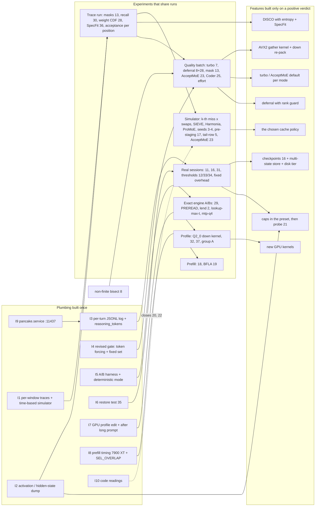

# A few shared pieces of plumbing unlock ten families of techniques

The more than 200 techniques in the nine reports reduce to **ten families**, grouped by the mechanism they touch. Three of them compete for the same budget: **the 17.4 ms of CPU experts in a 37.4 ms edit window** (47%). These are fewer expert bytes, where experts live and when they move, and CPU/GPU overlap. Their gains **do not add up**: together they cannot bring the edit window below the ~20 ms floor (GPU 15.8 + draft 2.5 + ~1.7 ms sync), i.e. a theoretical ceiling of ~1.9x on edits and ~1.27x on short chat ([PP][pp]). Two other families, per-turn cache and thinking control, are measured in seconds per turn, not in milliseconds per window. They target **~18% of turn time (re-reads)** and the thinking tail (p99 of 224 s). The practical conclusion is that the right order is not set by papers or items, but by **plumbing built once**: a routing trace format with the time-based simulator, a dump hook for activations and hidden states, the per-turn JSONL log with `reasoning_tokens`, the revised quality gate, the restore-equivalence test (item 35) and the GPU profile on the edit window. With these, over 25 items become experiments that share the same runs. The families with a low ceiling or already tested can be set aside: attention/GDN prefill until measured, expert predictors, prompt and KV compression, draft trees. The report contains no new measurement: all numbers come from the nine reports and from [MOD_PLAN][mp], and the combined ceilings are estimates.

A few conventions. The source abbreviations are: **PP** (Pancake pain points), **Up** (Avalon upgrades), **Stan**, **MIT**, **USA**, **EU**, **Asia**, **Can**, **Pac** (the regional reports) and **MP** (MOD_PLAN). "Item N" points to the list in phase 11 of MOD_PLAN. "Exact" means the same greedy text as the base. "Lossy" means the text may change, behind an opt-in flag. The status labels are: *done*, *branch* (a side branch of this session), *dan-cd* (engine, in the dan-cd session's queue), *coded, not enabled*, *queued*, *not started*, *tested, no gain*, *closed* and *owner decision*.

## Ten mechanisms explain the whole series

The table below is the map of the whole report. The "realistic ceiling" column is an estimate that starts from the measured floors. It is not a sum of the gains claimed by the authors, and the logic behind each number is explained in the family sections.

| # | Family (mechanism) | Pain targeted | Measured share | Theoretical ceiling | Realistic ceiling (estimate) |
|---|---|---|---|---|---|
| F1 | Fewer expert bytes per token (skipped rows, replaced experts) | CPU experts | 17.4 ms / 37.4 edit (47%); 5.2 / 24.8 short (21%) | shared with F2+F3: ~1.9x edit, ~1.27x short | +30–50% with turbo alone (measured); with sparsity on top, +10–20% over the rest |
| F2 | Where experts live and when they move (exact) | the same CPU experts; the 125→105 tok/s drop after long prompts | same; 9,412 borrowed slots | same | +5–16% edit from admission, +20% on turns after long prompts |
| F3 | Hiding CPU/PCIe latency (overlap) | GPU waiting for CPU rows | 38.3% of GPU kernel time is spin in `combine_cpu` | same | +10–25% edit after the fix (deferral), +1–4% barriers |
| F4 | Drafting and verification | tokens per window; 55–66% acceptance after 11.7K | draft 2.2–2.5 ms (6.7–9%) | ~+10% | +3–10% |
| F5 | Per-turn cache and checkpoints | prompt re-reads | ~18% of turn time (lower bound) | ~18% | 10–15% of turn time; compaction only in the harness |
| F6 | Thinking control | uncapped thinking, `xhigh` by default | ~6.6% of turn time plus the p99 tail | the p99 tail | tail cut to 1–2 min; −20–40% thinking on routine turns |
| F7 | Prefill: attention and GDN | long cold reads | unmeasured on the 7900 XT (the "GDN 22%" figure comes from the 3060) | 5–11% of prefill (GDN) | small after F5; BFLA probably slower than QSA on Flash-Next |
| F8 | GPU kernels and launch overhead | the GPU floor | 15.9 ms / 24.8 short (64%); ~0 on edits today | ~6% on short with a 10% faster GPU | 4–10% on short; grows when F1–F3 succeed |
| F9 | Quality and measurement | blind lossy decisions; ~20% run-to-run variance | gates F1, F3, F4, F6 | — | — (plumbing) |
| F10 | Agent harness, opencode and operations | pancake not wired to opencode; 28–65 s restart; fixed 0.5–0.9 s overhead per turn | gates every visible gain | — | precondition |

### F1. Fewer expert bytes: three ways to read less

The CPU pool already runs at **~27 GB/s of the 33 GB/s DDR4** measured. Three physical exits remain: fewer bytes, hidden bytes, or routing that avoids them ([PP][pp]). F1 contains the first, lossy variants. They split into three subgroups. The first skips **rows inside an expert** (activation sparsity). The second replaces or skips **whole experts** (routing toward resident experts, tail skip). The third changes **what a byte costs** (file choice, format kernels). The biggest measured gain of the whole series is here: **turbo-hip at 149–169 tok/s against 128.7 for C-best** ([PP][pp]). The clearest counterexample is here too: the router bias in upstream Strata gave +37% decode, but lowered the agent score from 5.6 to 4.5/10 ([Up][up]).

| Technique | Source | Item | Exact? | Status |
|---|---|---|---|---|
| Intra-expert mask on \|gate\| (Berkeley, 84.5–87.4% on Qwen3.5 MoE) | USA | 13 | lossy | dan-cd, not started |
| TEAL (threshold on the down input, MIT) | MIT | 13 | lossy | dan-cd, in the same offline pass |
| CATS (threshold on \|SiLU(gate)\|, falls to 40% on dense) | Stan | 13 | lossy | included only as a reference |
| CHESS (per-channel thresholds) | Asia | 13 | lossy | the fourth mask |
| SpAx (top-k on the down input) | Can | 13 | lossy | the fifth mask |
| Per-family thresholds (Warsaw/Sapienza), union sparsity over w = 1/2/4/8 (BlockFFN) | EU, Asia | 13 | — | columns in the offline pass |
| turbo-hip / `STRATA_ROUTE_PRIOR 0.5` (validated by Cache-Conditional Experts, Qualcomm) | EU, PP | 7 | lossy | built and measured; owner decision |
| AcceptMoE: depth-graded prior, position 0 exact | EU | 23 | lossy | not started (engine unassigned) |
| "Sibling-aware" OEA in the verify window | MIT | — | lossy | idea, low ceiling |
| BuddyMoE, MoBiLE, AdapMoE, HOBBIT weight-based precision | Asia | — | lossy | variants of turbo; parked |
| `STRATA_ROUTE_TAIL_SKIP 7` / tail-row drop with real MTP confidences | MP, Up | 5 | lossy | tail skip measured 129.7 tok/s; 5 not started |
| The ISTA Coder variant (256/512 experts, 29.6 GB) | EU | 25 | different model | not started (one-evening A/B) |
| Q2_0 as the daily file (93.8 vs 70.3 tok/s at DASLab) | EU | 6 | different model | closed (Q2_0 chosen) |
| Native AVX2 IQ1_M kernel | EU | 24 | exact | 0 on Q2_0; skip |
| T-MAC (GEMV via LUT) | Asia | — | exact | only if the Q2_0 micro-benchmark shows compute-bound |
| Any-Precision, MC-MoE, MxMoE | Asia | — | lossy | parked: no bits to cut on Q2_0 |

The calculation that ties the family to the floor is the one from the USA report. The gate mask reads **0.33 + 0.67·(1−s)** of the expert, and TEAL **0.67 + 0.33·(1−s)**. At 85%, the mask reads ~43% of the bytes and TEAL ~72%. If the CPU part above the GPU floor shrinks proportionally, the ceiling is ~1.25x, and the realistic gain is 10–20% ([USA][us]). Asia tempers the number: union sparsity over an 8-token verify window drops from ~80% to ~71% ([Asia][asia]). Pancake computes CPU experts mostly in verify windows, so the "union over w" column is mandatory.

### F2. Where experts live and when they move: the exact lever, but paid in PCIe

F2 does not change the text. It only changes which expert is in VRAM when it is requested. The replay shows **tier 79.6% < LRU 89.5% < Belady 94.7%** in hit rate, but the whole series reached the same correction: on PCIe 3.0 a promotion costs **~115 µs against ~42 µs** of CPU compute, so a hit rate is not a time ([USA][us]; [MP][mp]). The time-based simulator built with the Baleen method (`tools/pancake/time_ceiling.py`) gave the numbers that matter: LRU loses ~20% on short chats, "second miss in 8" admission gains **+5..16% on edits**, and the tier at every window ×160 brings **+4..9%** ([PP][pp]). The best-localized loss in the engine also belongs here: the prompt path borrows **9,412 slots (12.6 GiB)**, and decode drops from ~125 to ~105 tok/s until the cache refills (item 2).

| Technique | Source | Item | Exact? | Status |
|---|---|---|---|---|
| Time-based simulator (Baleen: Belady with bypass, DDR contention, GPU slack) | USA | 14 | exact | done (`time_ceiling.py`) |
| Admission on the k-th miss | USA, EU, Asia | 14 | exact | dan-cd, in progress in the engine |
| `--adapt-swaps 64/96/160`, tier at every window | MP | — | exact | dan-cd, queued |
| Keeping the decode cache through long prompts (lend sweep) | MP, PP | 2 | exact | dan-cd, queued |
| SIEVE / S3-FIFO as a dynamic segment | USA | 14 | exact | not started (only at ≥5% in the simulator) |
| OpenEvolve on the simulator (ADRS) / Hawkeye classifier | USA | 14 | exact | not started |
| Harmonia (admission separate from migration), MoE-Infinity (early-layer bias), Fate | EU, Asia | 27 | exact | candidates for the simulator |
| The ProMoE planner (fragmented, cancellable transfer; reordered execution) | Asia | 30 | exact | simulator first |
| Predictors: Fate/HOBBIT (l+1, l+2), pre-attention (SmallThinker), MTP state (SP-MoE) | Asia | 30 | exact | offline recall test, not started |
| Per-domain / per-conversation seeds (`STRATA_DOMAIN_PROFILES`, `STRATA_CONV_WORKSET`) | MP, EU, Asia | 3–4 | exact | code merged; per-session traces missing |
| Expert profile learned on agent traces | MP | 8.6 | exact | done (+6.7%) |
| Expert pre-staging during tools (KVFlow applied to experts) | USA | 17 | exact | not started (simulator first) |
| Router lookahead on the GPU (`STRATA_LOOKAHEAD_GPU`) | MP | 10.2 | exact | done, default |
| `--pcie-frac 0`; the FreeToken q* split | MP, USA | 22 | exact | `--pcie-frac 0` done; 22 probably closes on reading the code |
| Fiddler threshold by token count (`STRATA_PREFILL_CPU_SHARE`) | USA | — | exact | code reading |
| ClassLRU, reuse-aware admission, L3 prefetch, Foresight (0.97), VRAM lending 10.5, per-layer budgets | MP | — | exact | tested, no gain |

The F2 ceiling comes from the simulator, not from the literature. The predictors in Asia report 84.7–97% accuracy on models with 8–64 experts, but **ProMoE gives only 1.09x over LRU** even on PCIe 4.0. Locally, the history predictors cover 20–29% of misses, and the lookahead 24–46% ([Asia][asia]; [MP][mp]). The estimate for F2 stays in the simulator's band: **+5–16% on edits**, plus +20% on the turns that follow a long prompt.

### F3. Hiding latency: the only family that does not reduce work

F3 keeps the bytes the same but moves them in time. **Expert deferral (KTransformers, SOSP'25)** gave −26% time per layer and +33% decode on DeepSeek-V3. Pancake has the mechanism (`STRATA_VERIFY_DEFER_CPU`, `_BELOW`, "never the last layer"), but on HIP it still produces **non-finite logits**, and the bisect is queued ([Asia][asia]; [PP][pp]). The symptom this family attacks shows in the rocprofv3 profile: **38.3% of GPU kernel time is `combine_cpu_k10_vec4`, which spins**, plus 4.1% `wait_flag_copy_i32` ([PP][pp]).

| Technique | Source | Item | Exact? | Status |
|---|---|---|---|---|
| Expert deferral (KTransformers) | Asia | 8 | lossy (small) | dan-cd; bisect for non-finite queued |
| Rank guard "top-2 or weight ≥ w" | Asia | 28 | lossy (small) | dan-cd, after 8 |
| Per-expert barriers in the pool, fused SiLU·mul (`STRATA_POOL_FUSE_PHASES`) | Asia | 29 | exact | dan-cd; coded, A/B queued |
| `STRATA_POOL_PREREAD` (from tandem.cpp) | MP | — | exact | A/B queued |
| Athena epoch bandit for pre-read | EU | — | exact | only if the pre-read A/B comes out mixed |
| COMBINE_CPU, WAIT_FUSE, ROUTE_PUBLISH (RDNA3 ports) | MP | — | exact | done |
| PcieAuto "finish together" | MP | 10.4 | exact | done (share 0.20–0.25) |
| ProMoE reordered execution (cache → in flight → CPU) | Asia | 30 | exact | to check in the code |

The F3 ceiling depends on what F1 and F2 leave. Deferral can hide at most the CPU part that overlaps with the next layer's GPU work. On edits, with CPU 17.4 ms against GPU 15.8 ms, the Asia estimate is **+10–25%**. If turbo or admission already reduce the CPU rows, less remains to hide.

### F4. Drafting and verification: pancake is already close to optimal

MOD_PLAN and the Asia report show that pancake already does what Qwen recommends: `--spec 4`, the depth at which Qwen reports **4.07 accepted tokens**, and `--spec 3/5/6` came out flat ([Asia][asia]). Acceptance is 71% on short chat, 94% on edits and **55–66% after 11.7K prompts** ([PP][pp]). What remains in the family is the stop rule and the cost of each position in new experts.

| Technique | Source | Item | Exact? | Status |
|---|---|---|---|---|
| MTP `--spec 4`, `--spec-min-p 0.5`, DraftPolicy, SuffixDrafter | MP, USA, Asia | — | exact | done |
| DISCO (learned chain stop; 9 features, including `miss_`) | EU, Asia | 15 | exact | branch `feat/disco` |
| Entropy of the drafter's distribution (MiMo, Entropy Sentinel) as a feature | Asia, Pac | 15, 36 | exact | not started, on `feat/disco` |
| SpecFit: new missed experts per position (marginal cost) | Pac | 36 | exact | not started (variance logging first) |
| Draft source as an action (Mila bandit) | Can | 15 | exact | only if the DraftPolicy logs show wrong choices |
| Suffix index shared across sessions, frequency scoring (SuffixDecoding) | USA | 15 | exact | not started (`--simulate` first) |
| `--lookup-max-t 12/16` | Up, MP | — | exact | A/B queued (+1% in the first test) |
| MTP in the verify graph | MP | 10 | exact | waits for draft timing |
| `--mtp-q4` | PP | — | exact? | queued |
| ReplaySSM / SpecLA audit of the GDN replay | USA, Asia | 20 | exact | not started (code reading) |
| SSD-lite (Saguaro): drafts prepared while the GPU verifies | Stan | — | exact | not started; the CPU is already busy |
| Typical acceptance only on thinking (Medusa) | USA | — | lossy | not started, low priority |
| Draft trees (Staged SD, SpecInfer, Sequoia), Lookahead/Jacobi, Token Recycling | Stan, USA, Asia | — | — | skip |
| Cactus (acceptance with a KL budget) | Can | — | lossy | parked (~0 at T=0.1) |
| DFlash2 | MP | — | exact | tested: 115.9 but 84.3 after a long prompt |

The draft takes 2.2–2.5 ms. Even halved, it would bring only 3–5% on short chats ([PP][pp]). The family's real gain goes through the tok/s numerator: more accepted tokens per window, without more new experts. Estimate: **+3–10%** combined.

### F5. Per-turn cache and checkpoints: seconds, not milliseconds

The opencode history (2,063 turns on the old backend) shows that **90.8% of turns hit the cache**. Even so, three kinds of re-reads add up to ~2 hours of prefill out of ~11.4 hours of turns ([PP][pp]): **207 turns in the same session** that re-read more than the prompt grew (~8%), **~103 switches between sub-agents** (~7%) and **38 compactions** (~2–3%).

| Technique | Source | Item | Exact? | Status |
|---|---|---|---|---|
| Restore-equivalence test (UNSW: off-by-one on `cache_n`/`prompt_n`) | Pac | 35 | — (test) | not started; this session |
| End-to-end `preserve_thinking` (does opencode resend `reasoning_content`?) | Asia | 31 | exact | unchecked; this session |
| Message-boundary checkpoint + tail (`STRATA_CACHE_MESSAGE_BOUNDARY`, `--prompt-cache-tail`) | Up, MP | 11 | exact | existing opt-in; test arms queued |
| Checkpoints at tool-call/tool-result boundaries, Marconi FLOP/byte eviction, FreeToken | USA | 16 | exact | not started (engine.md assigns it to dan-b5) |
| RadixAttention multi-state store, Continuum/MORI TTL | Stan, USA | 3, 16 | exact | partial (small parking: 5.4–6.1 GiB for 4 conversations) |
| Disk tier (#28092, FastStrata `--conversation-disk`), sleep-in-place | Up, MP | 9 | exact | not started (phase 7) |
| `env_to_user`, stable system prefix, "tools first" reordering | Up, Stan | — | exact | `env_to_user` done; reordering not started |
| #24891 / #30745 (invalidation after tools, last-user-end) | Up | — | exact | ideas for Avalon; analogous to 11 |
| ContextPilot (block dedup) | EU, PP | — | breaks the prefix | tested: 1.6% on 40 sessions; off |
| Entropy Gate, non-prefix Prompt Cache | Pac, USA | — | breaks the prefix | skip |

The ceiling is that of in-session re-reads plus switches: **~15% of turn time**, as a lower bound, because prefill at 64–120K is slower than the 11.7K rate used in the calculation. Compaction cannot be fixed in the engine.

### F6. Thinking control: code written, nothing enabled

The caps already exist in code: `reasoning_budget_by_effort` (5dd620fb9), `reasoning_budget_grace` (the Maya soft close) and `reasoning_close_retry` (#1053). But none appears in any preset, and opencode sends `reasoning_effort: "xhigh"` by default ([PP][pp]). The **15 turns cut at 8K–32K tokens cost 2,726 s**.

| Technique | Source | Item | Exact? | Status |
|---|---|---|---|---|
| Per-effort-level cap (s1 budget forcing) | Stan | 12 | lossy | coded, not enabled |
| Soft close at the cap (Interruptible LRMs, Maya grace 512) | USA, MP | 12 | lossy | coded, not enabled |
| Default `medium` effort with escalation (ALP, Overthinking, NoThinking, Don't Overthink) | Stan, USA, EU | — | lossy | hypothesis; Qwen warns that low effort can lengthen tasks |
| Learned stopping on hidden states (Thought Calibration, OS-Pruner) | MIT | 21 | lossy | not started; this session |
| Per-turn effort probe (Learning How Hard to Think) | MIT | 21 | lossy | not started |
| Rumination: the 5-gram rate (Thoughtology) | Can | 34 | log-only, then lossy | not started |
| Top-k entropy (Entropy Sentinel) as a signal | Pac | 36 | log-only | not started |
| Mechanical turns as data (AdaptThink, Thinkless) | Asia | 21 | — | not started |
| Delethink (reset at boundaries) | Can | 16 | lossy | only if turns with >16K thinking show up |
| Dynasor early exit | MP | 12 | lossy | replaced by 21 |

The literature supports the cap. The reports admit, however, that **no paper evaluated effort levels on agentic coding turns**. So a cap that only cuts the tail above p99 (~4–5K tokens, estimated) is the low-risk decision. A "medium" default stays a hypothesis to put through the gate.

### F7. Attention and GDN prefill: unmeasured, so set aside for now

The only prefill breakdown comes from the 3060, and MIT's "GDN 22%" figure has no local source ([PP][pp]). Without `STRATA_PREFILL_TIMING` on the 7900 XT, the family has no share.

| Technique | Source | Item | Exact? | Status |
|---|---|---|---|---|
| GDN chunk 64 with 16x16 block inversion and fused prep | MIT | 18 | exact | not started (waits for prefill timing) |
| BFLA: a single shared QSA selection over a tile of queries | Asia, PP | 19 | lossy | branch `feat/bfla-hip`, prototype; `STRATA_SEL_OVERLAP` first |
| XAttention | MIT | 19 | lossy | replaced by BFLA |
| hipBLASLt table 100401 | Up, MP | — | exact | done (1,850–1,920 vs 1,345 tok/s) |
| Fused int8 prompt experts | MP | — | exact | done (silently lost with `STRATA_PREFILL_MMQ=OFF`) |
| KVA, exact QSA scorer | Up | — | lossy / exact | skip (decode −11%; only >131K) |

BFLA shows why the family has a low ceiling here. The prompt path already runs **sparse QSA with 2,051 cells per query**, and the BFLA budget, up to 32K cells, would be slower ([PP][pp]). GDN chunk 64 would bring **5–11% of prefill**, but only on the cold reads that F5 does not remove.

### F8. GPU kernels: they matter on short chat and only after F1–F3

| Technique | Source | Item | Exact? | Status |
|---|---|---|---|---|
| rocprofv3 profile on a short request | MP, PP | 1 | — | done (395 kernels per token) |
| Profile on the edit window and after a long prompt | PP | 1 | — | not started |
| Expdec-style down kernel for Q2_0 at n_ff 640 (`native_down_multi_kernel<42>` = 5.79%) | PP | new | exact | not started, unassigned |
| Gated Residual small-M (Mix/Combine kernels for M = 1–8) | Asia | 32 | exact | not started |
| Coordinate-descent sweep over launch/tile parameters (UFMG) | Pac | 37 | exact | not started |
| Group A switches, one at a time | MP | 1 | exact | in bisect |
| Hyper-connection reads (~2.73 ms), the VRAM-hit phase (3.3 ms) | MP | 1 | exact | targets after the profile |
| WMMA decode attention (BitDecoding) | Asia, PP | — | exact | branch `feat/bitdecoding-hip`; ~2–3% unconfirmed |
| FLUTE-style duplicated LDS, LongSpec audit of the verification | MIT, Asia | — | exact | only if the profile shows them |
| HIP graphs, GDN decode megakernel, global unroll | MP, Up | — | exact | tested, no gain |

If every GPU component were 10% faster, the short window would drop by ~1.6 ms (~6%). On edits the gain would be close to zero while the GPU waits for the CPU ([PP][pp]). The Q2_0 down kernel would be worth ~0.3–0.6 ms on the short window.

### F9 and F10. Measurement and the harness: no gain of their own, but they gate everything

F9 gathers the quality gates and the A/B tools. The central correction comes from Canada: **"Displacement Is Not Direction"** shows that KLD and top-1 agreement have **ρ = +0.00** with the task score on Qwen3.6-A3B in the "quiet zone". So token forcing can only reject large deviations, and a fixed task set decides between close variants ([Can][can]). F10 gathers everything about opencode and the service lifecycle. The biggest practical problem is also the cheapest: **pancake is not wired to opencode** (port 8080 instead of 11437, no systemd unit) ([PP][pp]).

| Technique | Source | Item | Status |
|---|---|---|---|
| The revised gate: token forcing (filter) → LCB subset + BFCL v4 multi-turn + checkpoints from our own repo, repeated runs | Can, USA, MP | quality gates | rule written, harness not built |
| EAR (SLQ, ISTA), SWT-Bench Lite, HELMET, Terminal-Bench subset, area under the time curve (SWE-Effi) | EU, USA, Stan, Can | — | not started |
| Deterministic test mode + A/B harness with load gate, distributions | PP, USA (M4), MP phase 14 | — | not started |
| `pancake.service` with `Conflicts=`, `PORT=11437`, `strata-coder` context = 131072 | PP | — | not started; this session |
| `reasoning_tokens` in the chat usage + per-turn JSONL log | PP | phase 14.1 | not started; this session |
| Maya loop guard, tolerant tool calls, grammar after `</think>` | MP, Asia | — | done |
| Behaviour counters (UBC), ECLoop-lite, STAIR-lite, AWM | Can, USA | 33 | not started |
| `oldString` constraint (ETH type-constrained), `presence_penalty = 0` | EU | 26 | 26 has almost nothing to fix (1 failure in 180 edits) |
| Slipstream, ACE, GEPA, RLM, AsyncFC, ContextSniper, AST search | USA, Stan, MIT, Asia | — | opencode harness, not started |
| `MADV_SEQUENTIAL`, disk sessions, hugepages, RAM_KEEP vs arena | Up, MP | 9 | not started / owner decision |
| Official sources + SHA-256 (Mind the Gap), AgentDojo | EU | — | not started |

## Substitutes, complements and conflicts

The basic rule is simple. **Techniques that touch the same time budget are substitutes**, and the combined gain is capped by the floor. **Techniques that touch different budgets are complements** and multiply. **Conflicts** appear when one technique breaks another's premise: the exact prefix, the GDN state, the expert union or DDR4 bandwidth.

### Substitutes: the same budget, gains that do not add up

| Substitute group | Shared budget | Why they do not add up | Combined ceiling (estimate) |
|---|---|---|---|
| Sparsity masks (13) vs turbo (7) vs AcceptMoE (23) vs tail skip / MoBiLE / HOBBIT vs deferral (8) | the 17.4 ms of CPU experts on edits (5.2 on short) | turbo takes experts off the CPU, so sparsity has fewer rows to thin. Deferral hides what remains, so it gains less after the first two. All stop at the ~20 ms floor | ~1.9x edit, ~1.27x short theoretical; realistically **+40–60% on edits** over fast-hip, with turbo plus one of the others |
| turbo (7) vs AcceptMoE (23) vs OEA vs BuddyMoE | the same top-10 re-selection in `verify.cpp` | all modify the same verified set. AcceptMoE is the "turbo with no cost at position 0" variant | pick **one**. AcceptMoE sits between fast-hip and turbo (5–15% over fast-hip) |
| Berkeley / TEAL / CATS / CHESS / SpAx masks | the same CPU expert bytes | a single criterion runs in the gather kernel | the winner of the offline pass: 10–20% (1.25x ceiling) |
| Admission on k-th miss vs SIEVE / S3-FIFO vs evolved policy vs Hawkeye vs Harmonia | the VRAM admission/eviction decision | a single policy runs. All are capped by Belady with bypass | the simulator band: **+5–16% edit** for the best one, not their sum |
| Predictors (30) vs router lookahead (done) vs seeds 3–4 vs pre-staging 17 | experts fetched before the request | the lookahead already covers the next layer. The seeds cover the start of the request. The PCIe budget is ~8–12 confident experts per layer | +0.6–1.5 hit points from seeds; predictors only at recall@16 ≥ 80% |
| `--spec-min-p`, DISCO, SpecFit, draft source as a bandit | choosing the window's length and source | all answer "how many positions do I verify" | 0–10% combined |
| Fixed cap (12) vs learned stopping (21) vs rumination (34) vs lower effort | thinking tokens | each cuts from the same thinking. The cap stays as the safety net | −20–40% on routine turns (estimate), plus the p99 tail |
| Message checkpoint (11) vs tool checkpoint (16) vs multi-state store vs disk tier | in-session re-reads and those on switches | a deeper checkpoint makes a shallower one on the same turn useless | ~15% of turn time |
| AsyncFC vs expert pre-staging (17) vs async compaction (Slipstream) | the window in which the GPU waits for a tool | a single GPU slot: whatever runs in the tool window takes it from the others | depends on the duration of local tools (milliseconds to seconds) |

### Complements: different budgets that multiply

The cleanest complementary pairs cross the boundary between window and turn. Any gain from F1–F3 shortens decode. F5 shortens prefill. F6 shortens the number of decoded tokens. On a typical "re-read + thinking + answer" turn, the three multiply. There is also a less obvious complementarity in time: **F8 becomes valuable only after F1–F3 succeed**. As long as the CPU exceeds the GPU on edits, a faster GPU kernel only grows the spin in `combine_cpu`. Once the CPU part drops below ~15.8 ms, the GPU floor becomes the limit on edits too. In F4, DISCO (the length) and AcceptMoE (the verified set) are complements: one picks how many positions get verified, the other which experts the verification uses. SpecFit ties them together through the marginal cost of new experts at each position ([Pac][pac]). In F2, seeds 3–4 and admission on the k-th miss are partial complements. The seed sets a lower bound at the start of the request, and admission decides the rest. But both need the same per-session traces. In F3, per-expert barriers (29) and deferral (8) complement each other: 29 shortens the sync inside the pool, 8 overlaps the pool with the GPU.

### Conflicts: one technique breaks another's premise

| Conflict | Mechanism | Result |
|---|---|---|
| Prompt rewriting (ContextPilot, Entropy Gate, KV compression, compaction) vs exact-prefix cache | the GDN state depends on the whole prefix, so any earlier changed token invalidates the checkpoint | ContextPilot stays off. Compaction is done rarely and through deltas (ACE), and large data is externalized (RLM). Filtering *new* tool output (ContextSniper) is compatible, because it touches only the suffix |
| `preserve_thinking` not honoured by opencode vs the conversation cache | the prefix diverges at the first dropped `<think>` block | a logged request decides. The checkpoint after `</think>` (16) depends on the answer |
| Draft trees vs the GDN state and the expert union | each branch needs a state copy and wakes other experts | trees stay excluded. Chains with DISCO are the right shape |
| Longer drafts (Cactus, `--lookup-max-t 16`, deeper MTP, Token Recycling) vs union misses | each extra position brings new experts on the CPU | `--spec 3/5/6` came out flat. Any lengthening must be priced with SpecFit/DraftPolicy |
| Prefetch and pre-read (`POOL_PREREAD`, DMA promotions) vs CPU experts | the same DDR4, already at ~80% | L3 prefetch came out worse. Pre-read is accepted only from an A/B, possibly with the Athena bandit |
| Deferral vs the fused combine paths | `cfuse` is off when deferring; the suspects for non-finite are WAIT_FUSE, ROUTE_PUBLISH, GR_FUSED, QDEDUP, ADAPT_OVERLAP, EXPDEC | the 6-run bisect is a precondition for 8 and 28 |
| Deferral vs turbo | turbo re-picks the top-10, and item 28's rank guard looks at the top-2 | they must be measured together, not only separately. The combined gain is below their sum |
| Sparsity (13) vs Q2_0/IQ2 | quantization and sparsity errors compound (FloE; Scaling Laws for Precision) | the revised gate, with tasks, is mandatory. KL alone is not enough |
| The n_ff-major down re-pack for 13 vs the RAM budget | a transposed copy of `down_exps` competes with the ~34 GB arena and with parked conversations | decided together with RAM_KEEP and the parking budget |
| Keeping the cache through long prompts (2) vs prompt speed | slot lending helps prefill and hurts the decode that follows | the lend sweep finds the balance point |
| RAM arena vs mmap (`STRATA_RAM_KEEP_GIB=20`) vs parked conversations | 57 GB split between arena, parking and system; the arena triggers oomd | a single RAM policy, decided with the sub-agent switch data |
| Lower effort vs task success | Qwen: low effort can bring more retries | decided on total time to success (Asia M5), not on time per turn |
| Grammar during thinking vs quality | "Let Me Speak Freely?" | any new constraint (26) stays after `</think>` |
| Deterministic mode for A/B vs the adaptive tier | adapt off changes exactly what the F2 items measure | F2 items are tested on distributions, not in deterministic mode |
| `avalon.service`, `strata.service` and pancake on port 11437 | the same port | `Conflicts=` in the pancake unit |

## The shared plumbing that unlocks the most items

The most important conclusion of the synthesis is that **many experiments need the same data**. The USA report already noticed this for traces: the infrastructure serves the cache ceiling, the ADRS search and the suffix-index simulation, so it "is built once" ([USA][us]). Extended to the whole series, the rule gives ten pieces of plumbing.

| # | Plumbing | What already exists | What is missing | Unlocks | Proposed owner |
|---|---|---|---|---|---|
| I1 | Per-window trace format (tokens, draft positions, accepted?, top-10 + weights per layer, resident/CPU/PCIe, timings) + the time-based simulator | `--dump-routing`, `conv_trace.py`, `time_ceiling.py`, `replay_cache_policy.py`, `predict_experts.py`, `replay_seeding.py` | the window fields: position, acceptance, weights for the missed experts | 14/27/30, 17, 3–4, 5 (tail-row drop), 23 (AcceptMoE replay), 28 (the weight CDF), 36 (SpecFit), 15 (DISCO training), Asia M3/M4 | dan-cd (engine) |
| I2 | Dump hook for activations and hidden states, plus FP32 zeroing | token forcing | dumping the intermediate activations per CPU expert; hidden states every 64 thinking tokens or at `\n\n` | 13 (all masks), 21 (the stop probe), the effort probe, the tool-argument probe | dan-cd for 13; this session for 21 (same hook) |
| I3 | Per-turn JSONL log + `reasoning_tokens` in usage | `thinking_n` counted internally | persistence on D; TTFT, `cache_n`, `prompt_n`, loop guard events, expert hit rate | 11, 16, 31 on real sessions; the values in 12; labels for 21; thresholds for 33/34; effort per task; the breakdown of the fixed 0.5–0.9 s overhead | this session |
| I4 | Harness for the revised gate (token forcing filter + fixed task set + repeated runs + EAR) | token forcing | the fixed set (LCB subset, BFCL v4 multi-turn, checkpoints from our own repo), the runner and the report as a distribution | 7, 8/28, 13, 23, 25, the default effort, 21, typical acceptance, the file choice | this session |
| I5 | A/B harness with load gate + deterministic mode + distributions | `queue.sh`, load gate | same-binary pairs, a verdict per line, overnight runs | all exact 1–5% items (29, 32, 37, the Q2_0 kernel, `--lookup-max-t`, the small-flag stack) | dan-cd (GPU queue) |
| I6 | Restore-equivalence test (35) | tests with fake engines (`test_ds4_restore_points.py`) | a GPU test: full and partial hit at each boundary type, with MTP on | 3 on resume, 11, 16, 31, disk tier, Delethink, multi-state store | this session |
| I7 | GPU profile on the edit window and after a long prompt (item 1 extension) | rocprofv3 harness for the short request | the same runs on an edit and after 11.7K | the Q2_0 down kernel, 32, 37, group A, FLUTE, BitDecoding, the LongSpec audit; confirms how much waiting is in `combine_cpu` | unassigned; run in the dan-cd queue |
| I8 | Prefill timing on the 7900 XT + prefill at 64K/120K + `STRATA_SEL_OVERLAP` | `STRATA_PREFILL_TIMING`, `strata_bench --long` | the run on the 7900 XT; the overlap counter | 18, 19 (BFLA), the Fiddler threshold, the re-read estimates | this session (19) + GPU queue |
| I9 | Wiring pancake to opencode | `run-pancake.sh` | unit, port, context, pinning oh-my-openagent | everything that depends on I3 and any visible gain | this session |
| I10 | Code readings that close items without writing code | the source | — | 22 (FreeToken split = `--pcie-frac`?), 20 (ReplaySSM), ProMoE reordered execution, the Fiddler threshold, read-before-edit in opencode | anyone, no GPU |

The dependency diagram starts from the plumbing, goes through the experiments that share the same runs, and ends at the features that are built only if the experiment passes.

## The optimized plan: four waves, with shared runs

The plan takes three constraints into account. The first is ownership: dan-cd has 2, 8/28, 13, 14/27/30 and 29, and this session has the server and agent items, plus the branches `feat/disco`, `feat/contextpilot`, `feat/bitdecoding-hip` and `feat/bfla-hip`. The second is **a single GPU**. Any measurement run from this session enters the same queue as dan-cd's A/Bs, so the value comes from packing as many questions as possible into a single run. The third is the ~20% run-to-run variance, which makes 1–5% A/Bs useless without I5.

| Wave | Steps | Shared runs (one run, several answers) | Owner |
|---|---|---|---|
| **0. No GPU, no risk** | I9 (unit, port 11437, `Conflicts=`, `strata-coder` context 131072); in the preset only the cap on the >p99 tail, `reasoning_budget_grace 512`, `reasoning_close_retry`; `reasoning_tokens` in usage; I3; the 2-line fix for the `MMQ=OFF` stub; `presence_penalty = 0` checked; I10 (closes 22 and possibly 20) | a single logged request answers 31 (does opencode resend `reasoning_content`?) | this session |
| **1. Measurement plumbing** | I1 (the window fields), I2 (the dump hook), I4, I5, I6 (35) | I6 is written once and run on every build that touches the cache | dan-cd: I1, I2, I5; this session: I3, I4, I6 |
| **2a. One trace run on the GPU** | a long, resumed opencode session with `--dump-routing`, activation sampling and the DISCO feature log | the same run feeds offline: masks 13 (+ the union-over-w column), recall 30, the weight CDF for 28, the SpecFit 36 variance, MTP acceptance per position (Asia M3), DISCO 15 training, the AcceptMoE 23 replay, tail-row drop 5, seeds 3–4, pre-staging 17 in the simulator | dan-cd for the run; the 15/36 analysis here |
| **2b. One profile run on the GPU** | rocprofv3 on an edit and after 11.7K, draft timing (item 10), the "PLE prefetch" time (Asia P7), `STRATA_PREFILL_TIMING` at 11.7K/64K/120K, `STRATA_SEL_OVERLAP` | a single harness, three questions: F8 (where the kernels go), F7 (are 18/19 worth it?), 10 (how much of the 2.2 ms is launch) | GPU queue; 19 here |
| **2c. The exact A/B batch** | factorial of k-th miss admission × `--adapt-swaps 64/96/160` (they interact, so together); 29; `POOL_PREREAD`; lend sweep (2); `--lookup-max-t 12/16`; `--mtp-q4` | the base arm is shared across the whole batch, on the same binary; `PREREAD` and admission are read together (same DDR4) | dan-cd |
| **2d. Deferral bisect** | 6 runs on the suspect switches | can be interleaved with 2c, on the same binary | dan-cd |
| **3a. The quality batch (one night)** | through I4: turbo-hip at two λ values (7); deferral with rank guard at windows 1/2/4/8 (8/28, after the bisect); the best mask (13, simulated by FP32 zeroing); AcceptMoE (23, if the replay looks promising); Coder (25); `medium` vs `xhigh` effort on total time to success | a single reference arm on tasks, then all the lossy variants; turbo and deferral measured **together** too, since they are substitutes | owner decision (7, effort); dan-cd (8/28, 13); 23 to assign |
| **3b. Per-turn cache on real sessions** | after 35: the 11 arms, the 16 triggers, the 31 fix, the parking budget decided with RAM_KEEP | all read from the same I3 log, on the same sessions | this session (31, 35); 16 per the notes from dan-b5 |
| **4. Features, only on a positive verdict** | the AVX2 gather kernel + re-pack (13 at ≥70%); the winning cache policy (14, only at ≥5% in the simulator); the Q2_0 down kernel and 32/37 after I7; DISCO with entropy + SpecFit; probe 21 (the cap stays as a net); the 33 counters and rumination 34 (log-only first); the compaction harness (Slipstream/ACE) | — | per the item's owner |

A few families and techniques deserve to be set aside on purpose, because their ceiling is low or because they have already been tested.

| Skip / parked | Reason |
|---|---|
| All of F7 (GDN chunk 64, BFLA) until after run 2b | prefill unmeasured on the 7900 XT; QSA already has 2,051 cells per query; F5 removes most repeated reads |
| Building predictors (30) and prefetch | the history predictors cover 20–29%, and ProMoE gives 1.09x on PCIe 4.0; only the recall column from run 2a is kept |
| Cache policies beyond admission on the k-th miss | ClassLRU, reuse-aware, L3, Foresight, per-layer budgets and VRAM lending have already failed; the rest only if the simulator shows ≥5% |
| Prompt and KV compression (ContextPilot, Entropy Gate, TurboQuant, KVQuant, OSCAR, KVzip) | breaks the exact prefix or attacks a small KV; ContextPilot measured at 1.6% |
| Draft trees, Lookahead/Jacobi, Cactus, Token Recycling, DFlash2 | GDN state forking, the expert union, ~0 at T=0.1, regression after long prompts |
| Mixed precision, Any-Precision, QuaRot, LQER, GSQ requantization | Q2_0 has no bits left to cut; the 354 GB BF16 does not fit |
| IQ1_M (24), T-MAC | 0 on Q2_0; T-MAC only if the micro-benchmark shows a compute-bound kernel |
| HIP graphs, GDN decode megakernel, global unroll | tested, no gain |
| `feat/bitdecoding-hip` as default | attention is ~3% of decode; stays opt-in until the ~2–3% is confirmed |
| 26 (the `oldString` constraint) | a single failure in 180 edits |

## Glossary: one sentence for each name

| Name | What it does, in short |
|---|---|
| Expert (MoE) | A small network out of the 512 per layer, from which the router picks 10 for each token. |
| Decode window | A cycle in which MTP proposes a few tokens, and the big model verifies all of them at once. |
| The GPU floor | The time the GPU works anyway in a window (~15.9 ms), below which the window cannot go. |
| Adaptive tier | The mechanism that decides which experts stay in VRAM, based on how often they are used. |
| Belady | The ideal cache policy, which knows the future; it serves only as a theoretical ceiling. |
| Belady with bypass (Baleen) | The ideal ceiling that promotes an expert only when near reuse pays for the PCIe cost. |
| Admission on the k-th miss | An expert enters VRAM only after it has been missed k times within a short period. |
| SIEVE / S3-FIFO | Simple caches with a probation queue, which filter out objects used only once. |
| OpenEvolve / ADRS | An LLM automatically evolves a cache policy on a simulator. |
| Hawkeye | A classifier that learns to imitate Belady's decisions. |
| Harmonia / Athena | Small controllers, learned online, that separate placement from migration or start prefetch based on benefit. |
| MoE-Infinity | Guesses a request's experts from similar past requests. |
| Router lookahead | Runs the next layer's router on the current layer's output, to learn early which experts come next. |
| Fate / HOBBIT / SP-MoE / SmallThinker predictors | Variants of guessing experts a few layers ahead, from different hidden states. |
| ProMoE | Transfers experts in cancellable pieces and runs the already available experts first. |
| Seeds 3–4 | Warm the cache with the experts typical of a domain or of a resumed conversation. |
| KVFlow (applied to experts) | Prepares the likely experts of the next turn while a tool runs. |
| `--pcie-frac` | What fraction of the missed experts goes up over PCIe to the GPU, instead of being computed on the CPU. |
| Expert deferral (KTransformers) | The less important experts finish on the CPU while the GPU moves on to the next layer. |
| Rank guard | The rule that always keeps the top two experts immediate, however small their weight. |
| Per-expert barriers | The CPU pool starts an expert's down as soon as its gate/up is done, without waiting for all experts. |
| `POOL_PREREAD` | Idle CPU threads read ahead the experts the lookahead announces. |
| `combine_cpu` spin | The time a GPU kernel sits waiting for the rows computed by the CPU. |
| Activation sparsity | Skips the rows of an expert whose activations are close to zero. |
| Gate mask (Berkeley) | Computes the full gate, then up/down only for the neurons above the threshold. |
| TEAL | Applies the threshold on the input of each matrix, calibrated layer by layer. |
| CATS | A global threshold on the gate's SiLU output; breaks down on dense models at 40%. |
| CHESS | Separate thresholds for each channel instead of a single one. |
| SpAx | Reads each column fully, approximately or not at all, by activation size. |
| Union sparsity over w | How many neurons stay inactive for all w tokens of a window at once. |
| n_ff-major re-pack | Rearranges `down` at load time, so that an inactive neuron saves a whole row. |
| turbo-hip / `STRATA_ROUTE_PRIOR` | Gives a bonus to experts already in VRAM when the router picks the top-10 (lossy). |
| Cache-Conditional Experts | The Qualcomm paper that externally validates the idea behind turbo. |
| AcceptMoE | The bonus toward resident experts grows with draft depth and is absent at position 0. |
| OEA (sibling-aware) | The bonus goes toward experts already picked by the other tokens in the same window. |
| Tail skip / tail-row drop | Skips low-rank missed experts or rows with low MTP confidence. |
| MoBiLE / AdapMoE / BuddyMoE | Use fewer experts or a resident "sibling" for unimportant tokens. |
| Q2_0 / IQ2_XS / Coder | Different ISTA-DASLab files of the same model: Q2_0 fast, IQ2_XS with lookup, Coder with half the experts. |
| MTP | The model's small head that proposes the next tokens (draft). |
| DraftPolicy | Picks the draft source and length at each step, based on measured cost and acceptance. |
| SuffixDrafter / SuffixDecoding | Proposes continuations found in text already seen; the CMU variant indexes several sessions. |
| DISCO | A classifier that decides when to stop the draft chain. |
| SpecFit | Prices each draft position by how many new experts it brings to verification. |
| `--lookup-max-t` | The maximum length of a prompt-lookup match used as a draft. |
| ReplaySSM / SpecLA | Cheaper ways to undo the recurrent state when a draft is rejected. |
| Cactus | Accepts drafts within a KL divergence budget; does nothing at greedy. |
| Draft tree | Several continuations proposed at once, in branches; expensive on a hybrid model with experts on the CPU. |
| Message-boundary checkpoint | The model state saved at the end of each message, so the next turn does not re-read the history. |
| Marconi / FreeToken | Checkpoints at tool boundaries, with eviction by compute saved per byte. |
| RadixAttention (multi-state store) | Keeps several prefixes at once, so sub-agents do not evict each other. |
| `preserve_thinking` | The thinking of previous turns stays in the prompt, so the cached prefix does not break. |
| Restore-equivalence test (35) | Checks that a conversation restored from the cache gives exactly the same tokens as a recomputed one. |
| ContextPilot | Dedups repeated blocks in the prompt; breaks the exact prefix and saved 1.6%. |
| `env_to_user` | Moves opencode's variable block out of the system prompt, so the prefix stays identical. |
| `reasoning_budget_by_effort` | The cap on thinking tokens, separate per effort level. |
| Soft close / grace | Closes the thinking at the first end of a sentence after the cap, not abruptly. |
| Thought Calibration / stop probe | A linear probe on the hidden states decides when thinking no longer adds anything. |
| Rumination (5-grams) | Measures how often the thinking returns to the same phrasing. |
| Entropy Sentinel | Uses the entropy of the token distribution as a cheap quality signal. |
| `xhigh` / `medium` effort | The thinking level requested by opencode; `xhigh` by default. |
| GDN chunk 64 | Processes the Gated DeltaNet layer in chunks of 64 tokens, with fewer serial steps at prefill. |
| QSA / BFLA | Sparse attention on the full-attention layers; BFLA shares the selection across a group of queries. |
| Q2_0 down kernel (expdec) | The missing fast kernel for the down projection of VRAM experts in the Q2_0 format. |
| Gated Residual small-M | Fused kernels for the 4-branch residual stream, at small windows. |
| UFMG sweep | Searches automatically, by coordinate descent, for the kernels' launch and tile parameters. |
| rocprofv3 | The AMD profiler that shows the time of each GPU kernel. |
| Token forcing | Compares two variants by forcing them on the same text and counting the tokens where they differ. |
| The revised gate | Token forcing only removes large deviations; a fixed task set decides between close variants. |
| EAR | The probability that a token of the variant is accepted by the reference. |
| BFCL v4 / LiveCodeBench / SWT-Bench | Task sets for tool calls, code and test generation. |
| Area under the time curve (SWE-Effi) | Measures how many tasks are solved as a function of time spent. |
| A/B harness with load gate | Runs base/variant pairs only when the machine is quiet and reports distributions. |
| Loop guard (Maya) | Stops repetitions and loops of identical tool calls. |
| Behaviour counters (33) | Count edits without a test and reads without an edit. |
| ECLoop / STAIR | "Read before editing, test before done" rules and abstract plans from successful sessions. |
| Slipstream / ACE / RLM | Async compaction, delta compaction and moving large data out of the prompt. |
| AsyncFC | The model keeps decoding while the tools run. |
| `MADV_SEQUENTIAL` | A hint to the kernel that the expert file is read sequentially, for a faster load. |
| RAM_KEEP / arena / mmap | Experts kept fully in RAM (the arena) or read on demand from the file (mmap, ~8% slower). |

## Conclusion

The series was read region by region, but synthesized by mechanism it says something different from any single report. Most engine levers are **variants of the same decision**: what happens to a missed expert. It can be thinned (F1), fetched early (F2) or hidden (F3), and the ~20 ms floor caps all of them together. That is why a plan that builds them one after another, each with its own A/B, pays three times for the same slice of time. A plan that measures them together, on the same traces and under the same gate, learns from the start how much is left after the best of them. The natural order becomes: first the biggest measured lever (the turbo decision), then the exact one (admission), then only what the floor still leaves.

The other implication is about pace. The slowest shared resource is not the code, but **the single GPU that both sessions share**. So every run must answer several questions. A single trace run on a resumed opencode session answers at least nine items offline. A single profile run decides F7 and F8. A single overnight quality batch judges all the lossy variants against the same reference arm. Until then, the cheapest real gains need no GPU at all: wiring to opencode, the tail cap on thinking and the per-turn log. Without them, no engine gain reaches the user and no per-turn lever can be validated.

[pp]: Pancake%20pain%20points%20and%20solutions.md
[mp]: file:///home/dan/clone-of-d/src/Strata/MOD_PLAN.md
[up]: Avalon%20upgrades%20from%20upstream%20projects.md
[stan]: Stanford%20papers%20useful%20for%20Avalon.md
[mit]: MIT%20Harvard%20papers%20for%20Avalon.md
[us]: US%20university%20papers%20for%20Avalon.md
[eu]: Europe%20papers%20for%20Avalon.md
[asia]: Asia%20papers%20for%20Avalon.md
[can]: Canada%20papers%20for%20Avalon.md
[pac]: Pacific%20Africa%20Latin%20America%20papers.md
