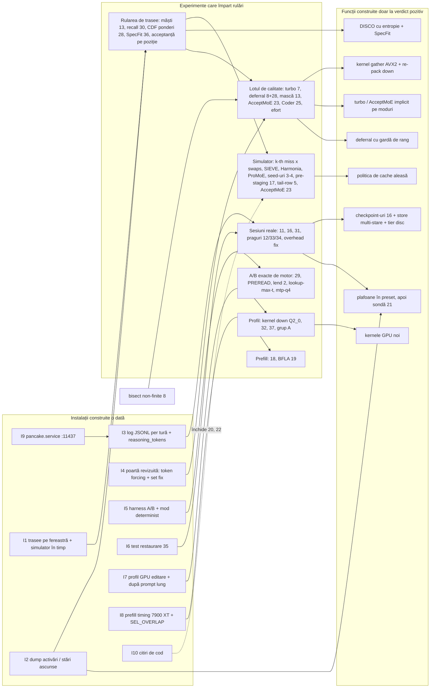

# Câteva instalații comune deblochează zece familii de tehnici

Cele peste 200 de tehnici din cele nouă rapoarte se reduc la **zece familii**, grupate după mecanismul pe care îl ating. Trei dintre ele se bat pe același buget: **cele 17,4 ms de experți CPU dintr-o fereastră de editare de 37,4 ms** (47%). Acestea sunt mai puțini octeți de expert, locul experților și momentul în care se mută, și suprapunerea CPU/GPU. Câștigurile lor **nu se adună**: împreună nu pot coborî fereastra de editare sub podeaua de ~20 ms (GPU 15,8 + draft 2,5 + ~1,7 ms sincronizare), adică un plafon teoretic de ~1,9x pe editări și ~1,27x pe chat scurt ([PP][pp]). Alte două familii, cache-ul per tură și controlul gândirii, se măsoară în secunde pe tură, nu în milisecunde pe fereastră. Ele țintesc **~18% din timpul turelor (re-citiri)** și coada de gândire (p99 de 224 s). Concluzia practică e că ordinea corectă nu se dă pe lucrări sau pe itemi, ci pe **instalații construite o singură dată**: un format de trasee de rutare cu simulatorul în timp, un hook de dump pentru activări și stări ascunse, logul JSONL per tură cu `reasoning_tokens`, poarta de calitate revizuită, testul de echivalență la restaurare (item 35) și profilul GPU pe fereastra de editare. Cu ele, peste 25 de itemi devin experimente care împart aceleași rulări. Familiile cu plafon mic sau deja testate pot fi lăsate deoparte: prefill-ul atenție/GDN până la măsurători, predictorii de experți, compresia de prompt și KV, arborii de draft. Raportul nu conține nicio măsurătoare nouă: toate cifrele vin din cele nouă rapoarte și din [MOD_PLAN][mp], iar plafoanele combinate sunt estimări.

Câteva convenții. Prescurtările surselor sunt: **PP** (Pancake pain points), **Up** (Avalon upgrades), **Stan**, **MIT**, **SUA**, **EU**, **Asia**, **Can**, **Pac** (rapoartele regionale) și **MP** (MOD_PLAN). „Item N” trimite la lista din faza 11 a MOD_PLAN. „Exact” înseamnă același text greedy ca baza. „Lossy” înseamnă că textul se poate schimba, cu flag opt-in. Etichetele de stare sunt: *gata*, *ramură* (side-branch al acestei sesiuni), *dan-cd* (motor, în coada sesiunii dan-cd), *cod gata, neactivat*, *în coadă*, *neînceput*, *testat fără câștig*, *închis* și *decizie owner*.

## Zece mecanisme explică toată seria

Tabelul de mai jos e harta întregului raport. Coloana „plafon realist” e o estimare care pornește de la podelele măsurate. Nu e o sumă a câștigurilor declarate de autori, iar logica fiecărei cifre e explicată în secțiunile de familie.

| # | Familie (mecanism) | Durerea țintită | Pondere măsurată | Plafon teoretic | Plafon realist (estimare) |
|---|---|---|---|---|---|
| F1 | Mai puțini octeți de expert pe token (rânduri sărite, experți înlocuiți) | experți CPU | 17,4 ms / 37,4 editare (47%); 5,2 / 24,8 scurt (21%) | comun cu F2+F3: ~1,9x editare, ~1,27x scurt | +30–50% doar cu turbo (măsurat); cu sparsitate în plus, +10–20% peste rest |
| F2 | Unde stau experții și când se mută (exact) | aceiași experți CPU; scăderea 125→105 tok/s după prompturi lungi | idem; 9.412 sloturi împrumutate | idem | +5–16% editare din admisie, +20% pe turele după prompturi lungi |
| F3 | Ascunderea latenței CPU/PCIe (suprapunere) | GPU care așteaptă rânduri CPU | 38,3% din timpul kernelelor GPU e spin în `combine_cpu` | idem | +10–25% editare după reparare (deferral), +1–4% bariere |
| F4 | Drafting și verificare | tokeni pe fereastră; acceptanță 55–66% după 11,7K | draft 2,2–2,5 ms (6,7–9%) | ~+10% | +3–10% |
| F5 | Cache și checkpoint-uri per tură | re-citiri de prompt | ~18% din timpul turelor (limită inferioară) | ~18% | 10–15% din timpul turelor; compactarea doar în harness |
| F6 | Controlul gândirii | gândire fără plafon, `xhigh` implicit | ~6,6% din timpul turelor plus coada p99 | coada p99 | coada tăiată la 1–2 min; −20–40% gândire pe turele de rutină |
| F7 | Prefill: atenție și GDN | citiri reci și lungi | nemăsurat pe 7900 XT (cifra „GDN 22%” vine de pe 3060) | 5–11% din prefill (GDN) | mic după F5; BFLA probabil mai lent decât QSA pe Flash-Next |
| F8 | Kernele GPU și overhead de lansare | podeaua GPU | 15,9 ms / 24,8 scurt (64%); ~0 pe editări azi | ~6% pe scurt la GPU cu 10% mai rapid | 4–10% pe scurt; crește când F1–F3 reușesc |
| F9 | Calitate și măsurare | decizii lossy oarbe; varianță de ~20% între rulări | condiționează F1, F3, F4, F6 | — | — (instalație) |
| F10 | Harness agent, opencode și operațiuni | pancake nelegat la opencode; repornire 28–65 s; overhead fix 0,5–0,9 s pe tură | condiționează tot câștigul vizibil | — | precondiție |

### F1. Mai puțini octeți de expert: trei feluri de a citi mai puțin

Pool-ul CPU rulează deja la **~27 GB/s din 33 GB/s DDR4** măsurați. Mai rămân trei ieșiri fizice: mai puțini octeți, octeți ascunși sau rutare care îi evită ([PP][pp]). F1 conține primele variante cu pierderi. Ele se împart în trei subgrupuri. Primul sare **rânduri în interiorul unui expert** (sparsitatea activărilor). Al doilea înlocuiește sau sare **experți întregi** (rutarea spre experții rezidenți, tail skip). Al treilea schimbă **cât costă un octet** (alegerea fișierului, kernelele de format). Cel mai mare câștig măsurat din toată seria e aici: **turbo-hip la 149–169 tok/s față de 128,7 pentru C-best** ([PP][pp]). Tot aici e și cel mai clar contraexemplu: router bias-ul din Strata upstream a dat +37% la decodare, dar a scăzut scorul de agent de la 5,6 la 4,5/10 ([Up][up]).

| Tehnică | Sursă | Item | Exact? | Stare |
|---|---|---|---|---|
| Masca intra-expert pe \|gate\| (Berkeley, 84,5–87,4% pe Qwen3.5 MoE) | SUA | 13 | lossy | dan-cd, neînceput |
| TEAL (prag pe intrarea down, MIT) | MIT | 13 | lossy | dan-cd, în aceeași trecere offline |
| CATS (prag pe \|SiLU(gate)\|, cade la 40% pe dens) | Stan | 13 | lossy | inclus doar ca referință |
| CHESS (praguri per canal) | Asia | 13 | lossy | a patra mască |
| SpAx (top-k pe intrarea down) | Can | 13 | lossy | a cincea mască |
| Praguri pe familie (Varșovia/Sapienza), sparsitate reunită pe w = 1/2/4/8 (BlockFFN) | EU, Asia | 13 | — | coloane în trecerea offline |
| turbo-hip / `STRATA_ROUTE_PRIOR 0.5` (validat de Cache-Conditional Experts, Qualcomm) | EU, PP | 7 | lossy | construit și măsurat; decizie owner |
| AcceptMoE: prior gradat pe adâncime, poziția 0 exactă | EU | 23 | lossy | neînceput (motor neatribuit) |
| OEA „sibling-aware” în fereastra de verificare | MIT | — | lossy | idee, plafon mic |
| BuddyMoE, MoBiLE, AdapMoE, HOBBIT precizie după pondere | Asia | — | lossy | variante ale lui turbo; parcate |
| `STRATA_ROUTE_TAIL_SKIP 7` / tail-row drop cu confidențe MTP reale | MP, Up | 5 | lossy | tail skip măsurat 129,7 tok/s; 5 neînceput |
| Varianta ISTA Coder (256/512 experți, 29,6 GB) | EU | 25 | alt model | neînceput (A/B de o seară) |
| Q2_0 ca fișier zilnic (93,8 vs 70,3 tok/s la DASLab) | EU | 6 | alt model | închis (Q2_0 ales) |
| Kernel AVX2 nativ IQ1_M | EU | 24 | exact | 0 pe Q2_0; de omis |
| T-MAC (GEMV prin LUT) | Asia | — | exact | doar dacă micro-benchmark-ul Q2_0 arată compute-bound |
| Any-Precision, MC-MoE, MxMoE | Asia | — | lossy | parcate: nu au biți de tăiat pe Q2_0 |

Calculul care leagă familia de podea e cel din raportul SUA. Masca pe gate citește **0,33 + 0,67·(1−s)** din expert, iar TEAL **0,67 + 0,33·(1−s)**. La 85%, masca citește ~43% din octeți, iar TEAL ~72%. Dacă partea CPU de peste podeaua GPU se micșorează proporțional, plafonul e ~1,25x, iar câștigul realist e 10–20% ([SUA][us]). Asia temperează cifra: sparsitatea reunită pe o fereastră de verificare de 8 tokeni scade de la ~80% la ~71% ([Asia][asia]). Pancake calculează experții CPU mai ales în ferestre de verificare, deci coloana „reunită pe w” e obligatorie.

### F2. Unde stau experții și când se mută: pârghia exactă, dar plătită în PCIe

F2 nu schimbă textul. Schimbă doar ce expert e în VRAM când e cerut. Replay-ul arată **tier 79,6% < LRU 89,5% < Belady 94,7%** în rată de hit, dar toată seria a ajuns la aceeași corectură: pe PCIe 3.0 o promovare costă **~115 µs față de ~42 µs** de calcul pe CPU, deci o rată de hit nu e un timp ([SUA][us]; [MP][mp]). Simulatorul în timp construit după metoda Baleen (`tools/pancake/time_ceiling.py`) a dat cifrele care contează: LRU pierde ~20% pe chaturi scurte, admisia „al doilea miss în 8” câștigă **+5..16% pe editări**, iar tier-ul la fiecare fereastră ×160 aduce **+4..9%** ([PP][pp]). Tot aici intră pierderea cea mai bine localizată din motor: calea de prompt împrumută **9.412 sloturi (12,6 GiB)**, iar decodarea scade de la ~125 la ~105 tok/s până se reumple cache-ul (item 2).

| Tehnică | Sursă | Item | Exact? | Stare |
|---|---|---|---|---|
| Simulator în timp (Baleen: Belady cu bypass, contenție DDR, slack GPU) | SUA | 14 | exact | gata (`time_ceiling.py`) |
| Admisie la al k-lea miss | SUA, EU, Asia | 14 | exact | dan-cd, în lucru în motor |
| `--adapt-swaps 64/96/160`, tier la fiecare fereastră | MP | — | exact | dan-cd, în coadă |
| Păstrarea cache-ului de decodare prin prompturi lungi (sweep lend) | MP, PP | 2 | exact | dan-cd, în coadă |
| SIEVE / S3-FIFO ca segment dinamic | SUA | 14 | exact | neînceput (doar la ≥5% în simulator) |
| OpenEvolve pe simulator (ADRS) / clasificator Hawkeye | SUA | 14 | exact | neînceput |
| Harmonia (admisie separată de migrare), MoE-Infinity (bias pe straturi timpurii), Fate | EU, Asia | 27 | exact | candidați pentru simulator |
| Planificatorul ProMoE (transfer fragmentat, anulabil; execuție reordonată) | Asia | 30 | exact | întâi în simulator |
| Predictori: Fate/HOBBIT (l+1, l+2), pre-atenție (SmallThinker), stare MTP (SP-MoE) | Asia | 30 | exact | test offline de recall, neînceput |
| Seed-uri per domeniu / per conversație (`STRATA_DOMAIN_PROFILES`, `STRATA_CONV_WORKSET`) | MP, EU, Asia | 3–4 | exact | cod merge-uit; lipsesc trasele per sesiune |
| Profil de experți învățat pe trasee de agent | MP | 8.6 | exact | gata (+6,7%) |
| Pre-staging de experți în timpul tool-urilor (KVFlow aplicat experților) | SUA | 17 | exact | neînceput (simulator întâi) |
| Router lookahead pe GPU (`STRATA_LOOKAHEAD_GPU`) | MP | 10.2 | exact | gata, implicit |
| `--pcie-frac 0`; split-ul FreeToken q* | MP, SUA | 22 | exact | `--pcie-frac 0` gata; 22 se închide probabil la citirea codului |
| Prag Fiddler după numărul de tokeni (`STRATA_PREFILL_CPU_SHARE`) | SUA | — | exact | citire de cod |
| ClassLRU, admisie reuse-aware, prefetch L3, Foresight (0,97), VRAM lending 10.5, bugete per strat | MP | — | exact | testate fără câștig |

Plafonul F2 vine din simulator, nu din literatură. Predictorii din Asia raportează 84,7–97% acuratețe pe modele cu 8–64 de experți, dar **ProMoE dă doar 1,09x peste LRU** chiar și pe PCIe 4.0. Local, predictorii istorici acoperă 20–29% din miss-uri, iar lookahead-ul 24–46% ([Asia][asia]; [MP][mp]). Estimarea pentru F2 rămâne în banda simulatorului: **+5–16% pe editări**, plus +20% pe turele care urmează unui prompt lung.

### F3. Ascunderea latenței: singura familie care nu reduce munca

F3 lasă octeții la fel, dar îi mută în timp. **Expert deferral-ul (KTransformers, SOSP'25)** a dat −26% timp pe strat și +33% la decodare pe DeepSeek-V3. Pancake are mecanismul (`STRATA_VERIFY_DEFER_CPU`, `_BELOW`, „niciodată ultimul strat”), dar pe HIP produce încă **logits non-finite**, iar bisect-ul e în coadă ([Asia][asia]; [PP][pp]). Simptomul pe care familia îl atacă se vede în profilul rocprofv3: **38,3% din timpul kernelelor GPU e `combine_cpu_k10_vec4`, care stă în spin**, plus 4,1% `wait_flag_copy_i32` ([PP][pp]).

| Tehnică | Sursă | Item | Exact? | Stare |
|---|---|---|---|---|
| Expert deferral (KTransformers) | Asia | 8 | lossy (mic) | dan-cd; bisect pentru non-finite în coadă |
| Gardă de rang „top-2 sau pondere ≥ w” | Asia | 28 | lossy (mic) | dan-cd, după 8 |
| Bariere per expert în pool, SiLU·mul fuzionat (`STRATA_POOL_FUSE_PHASES`) | Asia | 29 | exact | dan-cd; codat, A/B în coadă |
| `STRATA_POOL_PREREAD` (din tandem.cpp) | MP | — | exact | A/B în coadă |
| Bandit Athena pe epoci pentru pre-read | EU | — | exact | doar dacă A/B-ul pre-read iese amestecat |
| COMBINE_CPU, WAIT_FUSE, ROUTE_PUBLISH (porturi RDNA3) | MP | — | exact | gata |
| PcieAuto „finish together” | MP | 10.4 | exact | gata (share 0,20–0,25) |
| Execuția reordonată ProMoE (cache → în zbor → CPU) | Asia | 30 | exact | de verificat în cod |

Plafonul F3 depinde de ce lasă F1 și F2. Deferral-ul poate ascunde cel mult partea CPU care se suprapune cu lucrul GPU al stratului următor. Pe editări, cu CPU 17,4 ms față de GPU 15,8 ms, estimarea Asia este **+10–25%**. Dacă turbo sau admisia reduc deja rândurile CPU, rămâne mai puțin de ascuns.

### F4. Drafting și verificare: pancake e deja aproape de optim

MOD_PLAN și raportul Asia arată că pancake face deja ce recomandă Qwen: `--spec 4`, adâncimea la care Qwen raportează **4,07 tokeni acceptați**, iar `--spec 3/5/6` au ieșit plate ([Asia][asia]). Acceptanța e de 71% pe chat scurt, 94% pe editare și **55–66% după prompturi de 11,7K** ([PP][pp]). Ce mai rămâne în familie sunt regula de oprire și costul fiecărei poziții în experți noi.

| Tehnică | Sursă | Item | Exact? | Stare |
|---|---|---|---|---|
| MTP `--spec 4`, `--spec-min-p 0.5`, DraftPolicy, SuffixDrafter | MP, SUA, Asia | — | exact | gata |
| DISCO (oprire învățată a lanțului; 9 trăsături, inclusiv `miss_`) | EU, Asia | 15 | exact | ramură `feat/disco` |
| Entropia distribuției drafter-ului (MiMo, Entropy Sentinel) ca trăsătură | Asia, Pac | 15, 36 | exact | neînceput, pe `feat/disco` |
| SpecFit: experți noi ratați pe poziție (cost marginal) | Pac | 36 | exact | neînceput (întâi logarea varianței) |
| Sursa draft-ului ca acțiune (bandit Mila) | Can | 15 | exact | doar dacă logurile DraftPolicy arată alegeri greșite |
| Index de sufixe comun sesiunilor, scorare după frecvență (SuffixDecoding) | SUA | 15 | exact | neînceput (`--simulate` întâi) |
| `--lookup-max-t 12/16` | Up, MP | — | exact | A/B în coadă (+1% la primul test) |
| MTP în graful de verificare | MP | 10 | exact | așteaptă draft timing |
| `--mtp-q4` | PP | — | exact? | în coadă |
| Audit ReplaySSM / SpecLA al replay-ului GDN | SUA, Asia | 20 | exact | neînceput (citire de cod) |
| SSD-lite (Saguaro): drafturi pregătite cât verifică GPU-ul | Stan | — | exact | neînceput; CPU-ul e deja ocupat |
| Typical acceptance doar pe gândire (Medusa) | SUA | — | lossy | neînceput, prioritate mică |
| Arbori de draft (Staged SD, SpecInfer, Sequoia), Lookahead/Jacobi, Token Recycling | Stan, SUA, Asia | — | — | de omis |
| Cactus (acceptare cu buget KL) | Can | — | lossy | parcat (~0 la T=0,1) |
| DFlash2 | MP | — | exact | testat: 115,9 dar 84,3 după prompt lung |

Draft-ul ocupă 2,2–2,5 ms. Chiar înjumătățit, ar aduce doar 3–5% pe chaturi scurte ([PP][pp]). Câștigul real al familiei trece prin numărătorul tok/s: mai mulți tokeni acceptați pe fereastră, fără mai mulți experți noi. Estimare: **+3–10%** combinat.

### F5. Cache și checkpoint-uri per tură: secunde, nu milisecunde

Istoricul opencode (2.063 de ture pe backend-ul vechi) arată că **90,8% din ture lovesc cache-ul**. Cu toate astea, trei categorii de re-citiri adună ~2 ore de prefill din ~11,4 ore de ture ([PP][pp]): **207 ture din aceeași sesiune** care au re-citit mai mult decât a crescut promptul (~8%), **~103 comutări între sub-agenți** (~7%) și **38 de compactări** (~2–3%).

| Tehnică | Sursă | Item | Exact? | Stare |
|---|---|---|---|---|
| Test de echivalență la restaurare (UNSW: off-by-one pe `cache_n`/`prompt_n`) | Pac | 35 | — (test) | neînceput; sesiunea aceasta |
| `preserve_thinking` cap-coadă (retrimite opencode `reasoning_content`?) | Asia | 31 | exact | neverificat; sesiunea aceasta |
| Checkpoint la granița de mesaj + tail (`STRATA_CACHE_MESSAGE_BOUNDARY`, `--prompt-cache-tail`) | Up, MP | 11 | exact | opt-in existent; brațe de test în coadă |
| Checkpoint-uri la granițele tool-call/tool-result, evicție Marconi FLOP/octet, FreeToken | SUA | 16 | exact | neînceput (engine.md o trece la dan-b5) |
| Store multi-stare RadixAttention, TTL Continuum/MORI | Stan, SUA | 3, 16 | exact | parțial (parcare mică: 5,4–6,1 GiB pentru 4 conversații) |
| Tier pe disc (#28092, FastStrata `--conversation-disk`), sleep-in-place | Up, MP | 9 | exact | neînceput (faza 7) |
| `env_to_user`, prefix de sistem stabil, reordonare „tool-urile întâi” | Up, Stan | — | exact | `env_to_user` gata; reordonarea neîncepută |
| #24891 / #30745 (invalidare după tool-uri, last-user-end) | Up | — | exact | idei pentru Avalon; analoage cu 11 |
| ContextPilot (deduplicare de blocuri) | EU, PP | — | strică prefixul | testat: 1,6% pe 40 de sesiuni; oprit |
| Entropy Gate, Prompt Cache non-prefix | Pac, SUA | — | strică prefixul | de omis |

Plafonul e cel al re-citirilor din aceeași sesiune plus comutările: **~15% din timpul turelor**, ca limită inferioară, pentru că prefill-ul la 64–120K e mai lent decât rata de 11,7K folosită în calcul. Compactarea nu se repară în motor.

### F6. Controlul gândirii: cod scris, nimic activat

Plafoanele există deja în cod: `reasoning_budget_by_effort` (5dd620fb9), `reasoning_budget_grace` (închiderea lină din Maya) și `reasoning_close_retry` (#1053). Niciunul nu apare însă în vreun preset, iar opencode trimite implicit `reasoning_effort: "xhigh"` ([PP][pp]). Cele **15 ture tăiate la 8K–32K tokeni au costat 2.726 s**.

| Tehnică | Sursă | Item | Exact? | Stare |
|---|---|---|---|---|
| Plafon pe nivel de efort (s1 budget forcing) | Stan | 12 | lossy | cod gata, neactivat |
| Închidere lină la plafon (Interruptible LRMs, Maya grace 512) | SUA, MP | 12 | lossy | cod gata, neactivat |
| Efort implicit `medium` cu escaladare (ALP, Overthinking, NoThinking, Don't Overthink) | Stan, SUA, EU | — | lossy | ipoteză; Qwen avertizează că efortul mic poate lungi sarcinile |
| Oprire învățată pe stări ascunse (Thought Calibration, OS-Pruner) | MIT | 21 | lossy | neînceput; sesiunea aceasta |
| Sondă pentru efort per tură (Learning How Hard to Think) | MIT | 21 | lossy | neînceput |
| Ruminație: rata de 5-grame (Thoughtology) | Can | 34 | log-only, apoi lossy | neînceput |
| Entropie top-k (Entropy Sentinel) ca semnal | Pac | 36 | log-only | neînceput |
| Turele mecanice ca date (AdaptThink, Thinkless) | Asia | 21 | — | neînceput |
| Delethink (resetare la granițe) | Can | 16 | lossy | doar dacă apar ture >16K de gândire |
| Dynasor early exit | MP | 12 | lossy | înlocuit de 21 |

Literatura susține plafonul. Rapoartele recunosc însă că **nicio lucrare nu a evaluat nivelurile de efort pe ture agentice de cod**. Prin urmare, un plafon care taie doar coada de peste p99 (~4–5K tokeni, estimat) e decizia de risc mic. Un default „medium” rămâne o ipoteză de trecut prin poartă.

### F7. Prefill pe atenție și GDN: nemăsurat, deci deocamdată de lăsat

Singurul breakdown de prefill vine de pe 3060, iar cifra MIT „GDN 22%” nu are sursă locală ([PP][pp]). Fără `STRATA_PREFILL_TIMING` pe 7900 XT, familia nu are o pondere.

| Tehnică | Sursă | Item | Exact? | Stare |
|---|---|---|---|---|
| GDN chunk 64 cu inversare pe blocuri 16x16 și prep fuzionat | MIT | 18 | exact | neînceput (așteaptă prefill timing) |
| BFLA: o singură selecție QSA partajată pe un tile de query-uri | Asia, PP | 19 | lossy | ramură `feat/bfla-hip`, prototip; întâi `STRATA_SEL_OVERLAP` |
| XAttention | MIT | 19 | lossy | înlocuit de BFLA |
| Tabela hipBLASLt 100401 | Up, MP | — | exact | gata (1.850–1.920 vs 1.345 tok/s) |
| Experți int8 fuzionați pe prompt | MP | — | exact | gata (se pierd în tăcere cu `STRATA_PREFILL_MMQ=OFF`) |
| KVA, exact QSA scorer | Up | — | lossy / exact | de omis (decodare −11%; doar >131K) |

BFLA arată de ce familia are plafon mic aici. Calea de prompt rulează deja **QSA sparse cu 2.051 de celule pe query**, iar bugetul BFLA, de până la 32K celule, ar fi mai lent ([PP][pp]). GDN chunk 64 ar aduce **5–11% din prefill**, dar doar pe citirile reci pe care F5 nu le elimină.

### F8. Kernele GPU: contează pe chat scurt și abia după F1–F3

| Tehnică | Sursă | Item | Exact? | Stare |
|---|---|---|---|---|
| Profil rocprofv3 pe cerere scurtă | MP, PP | 1 | — | gata (395 de kernele pe token) |
| Profil pe fereastra de editare și după prompt lung | PP | 1 | — | neînceput |
| Kernel down în stil expdec pentru Q2_0 la n_ff 640 (`native_down_multi_kernel<42>` = 5,79%) | PP | nou | exact | neînceput, neatribuit |
| Gated Residual small-M (kernele Mix/Combine pentru M = 1–8) | Asia | 32 | exact | neînceput |
| Sweep coordinate-descent pe parametri de lansare/tile (UFMG) | Pac | 37 | exact | neînceput |
| Switch-urile grupului A, unul câte unul | MP | 1 | exact | în bisect |
| Citirile hyper-connection (~2,73 ms), faza VRAM-hit (3,3 ms) | MP | 1 | exact | ținte după profil |
| Atenție de decodare WMMA (BitDecoding) | Asia, PP | — | exact | ramură `feat/bitdecoding-hip`; ~2–3% neconfirmat |
| LDS duplicat în stil FLUTE, audit LongSpec al verificării | MIT, Asia | — | exact | doar dacă profilul le arată |
| HIP graphs, megakernel GDN la decodare, unroll global | MP, Up | — | exact | testate fără câștig |

Dacă toate componentele GPU ar fi cu 10% mai rapide, fereastra scurtă ar scădea cu ~1,6 ms (~6%). Pe editări câștigul ar fi aproape zero cât timp GPU-ul așteaptă CPU-ul ([PP][pp]). Kernelul down pentru Q2_0 ar valora ~0,3–0,6 ms pe fereastra scurtă.

### F9 și F10. Măsurarea și harness-ul: fără câștig propriu, dar condiționează totul

F9 adună porțile de calitate și uneltele de A/B. Corectura centrală vine din Canada: **„Displacement Is Not Direction”** arată că KLD-ul și acordul top-1 au **ρ = +0,00** cu scorul la sarcini pe Qwen3.6-A3B în „zona tăcută”. Forțarea de tokenuri poate deci doar să respingă deviațiile mari, iar între variante apropiate decide un set fix de sarcini ([Can][can]). F10 adună tot ce ține de opencode și de viața serviciului. Cea mai mare problemă practică e și cea mai ieftină: **pancake nu e legat la opencode** (portul 8080 în loc de 11437, fără unitate systemd) ([PP][pp]).

| Tehnică | Sursă | Item | Stare |
|---|---|---|---|
| Poarta revizuită: token forcing (filtru) → LCB subset + BFCL v4 multi-turn + checkpoint-uri din repo propriu, rulări repetate | Can, SUA, MP | quality gates | regulă scrisă, harness neconstruit |
| EAR (SLQ, ISTA), SWT-Bench Lite, HELMET, Terminal-Bench subset, aria sub curba timpului (SWE-Effi) | EU, SUA, Stan, Can | — | neînceput |
| Mod de test determinist + harness A/B cu poartă de încărcare, distribuții | PP, SUA (M4), MP faza 14 | — | neînceput |
| `pancake.service` cu `Conflicts=`, `PORT=11437`, contextul `strata-coder` = 131072 | PP | — | neînceput; sesiunea aceasta |
| `reasoning_tokens` în usage-ul de chat + log JSONL per tură | PP | faza 14.1 | neînceput; sesiunea aceasta |
| Loop guard Maya, tool calls tolerante, gramatică după `</think>` | MP, Asia | — | gata |
| Contoare comportamentale (UBC), ECLoop-lite, STAIR-lite, AWM | Can, SUA | 33 | neînceput |
| Constrângere `oldString` (ETH type-constrained), `presence_penalty = 0` | EU | 26 | 26 aproape nimic de reparat (1 eșec la 180 de editări) |
| Slipstream, ACE, GEPA, RLM, AsyncFC, ContextSniper, căutare AST | SUA, Stan, MIT, Asia | — | harness opencode, neînceput |
| `MADV_SEQUENTIAL`, sesiuni pe disc, hugepages, RAM_KEEP vs arenă | Up, MP | 9 | neînceput / decizie owner |
| Surse oficiale + SHA-256 (Mind the Gap), AgentDojo | EU | — | neînceput |

## Substitute, complemente și conflicte

Regula de bază e simplă. **Tehnicile care ating același buget de timp sunt substitute**, iar câștigul combinat e plafonat de podea. **Tehnicile care ating bugete diferite sunt complemente** și se înmulțesc. **Conflictele** apar când o tehnică strică premisa alteia: prefixul exact, starea GDN, uniunea de experți sau lățimea de bandă DDR4.

### Substitute: același buget, câștiguri care nu se adună

| Grup de substitute | Bugetul comun | De ce nu se adună | Plafon combinat (estimare) |
|---|---|---|---|
| Măștile de sparsitate (13) vs turbo (7) vs AcceptMoE (23) vs tail skip / MoBiLE / HOBBIT vs deferral (8) | cele 17,4 ms de experți CPU pe editare (5,2 pe scurt) | turbo scoate experți din CPU, deci sparsitatea are mai puține rânduri de rărit. Deferral-ul ascunde ce rămâne, deci câștigă mai puțin după primele două. Toate se opresc la podeaua de ~20 ms | ~1,9x editare, ~1,27x scurt teoretic; realist **+40–60% pe editări** față de fast-hip, cu turbo plus una dintre celelalte |
| turbo (7) vs AcceptMoE (23) vs OEA vs BuddyMoE | aceeași re-selecție de top-10 în `verify.cpp` | toate modifică același set verificat. AcceptMoE e varianta „turbo fără cost pe poziția 0” | se alege **unul**. AcceptMoE stă între fast-hip și turbo (5–15% peste fast-hip) |
| Măștile Berkeley / TEAL / CATS / CHESS / SpAx | aceiași octeți din experții CPU | un singur criteriu rulează în kernelul gather | câștigătorul trecerii offline: 10–20% (plafon 1,25x) |
| Admisie la al k-lea miss vs SIEVE / S3-FIFO vs politică evoluată vs Hawkeye vs Harmonia | decizia de admisie/evicție în VRAM | o singură politică rulează. Toate sunt plafonate de Belady cu bypass | banda simulatorului: **+5–16% editare** pentru cea mai bună, nu suma lor |
| Predictori (30) vs router lookahead (gata) vs seed-uri 3–4 vs pre-staging 17 | experții aduși înainte de cerere | lookahead-ul acoperă deja stratul următor. Seed-urile acoperă începutul cererii. Bugetul PCIe e de ~8–12 experți încrezători pe strat | +0,6–1,5 puncte de hit din seed-uri; predictorii doar la recall@16 ≥ 80% |
| `--spec-min-p`, DISCO, SpecFit, sursa draft-ului ca bandit | alegerea lungimii și sursei ferestrei | toate răspund la „câte poziții verific” | 0–10% combinat |
| Plafon fix (12) vs oprire învățată (21) vs ruminație (34) vs efort mai mic | tokenii de gândire | fiecare taie din aceeași gândire. Plafonul rămâne plasa de siguranță | −20–40% pe turele de rutină (estimare), plus coada p99 |
| Checkpoint la mesaj (11) vs la tool (16) vs store multi-stare vs tier pe disc | re-citirile din aceeași sesiune și la comutări | un checkpoint mai adânc face inutil unul mai puțin adânc pe aceeași tură | ~15% din timpul turelor |
| AsyncFC vs pre-staging de experți (17) vs compactare asincronă (Slipstream) | fereastra în care GPU-ul așteaptă un tool | un singur slot GPU: ce rulează în fereastra de tool o ocupă pentru celelalte | depinde de durata tool-urilor locale (milisecunde până la secunde) |

### Complemente: bugete diferite, care se înmulțesc

Cele mai curate perechi complementare traversează granița dintre fereastră și tură. Orice câștig din F1–F3 scurtează decodarea. F5 scurtează prefill-ul. F6 scurtează numărul de tokeni decodați. Pe o tură tipică „re-citire + gândire + răspuns”, cele trei se înmulțesc. Există și o complementaritate în timp, mai puțin evidentă: **F8 devine valoros abia după ce F1–F3 au reușit**. Cât timp CPU-ul depășește GPU-ul pe editări, un kernel GPU mai rapid doar mărește spinul din `combine_cpu`. Odată ce partea CPU coboară sub ~15,8 ms, podeaua GPU devine limita și pe editări. În F4, DISCO (lungimea) și AcceptMoE (setul verificat) sunt complemente: unul alege câte poziții se verifică, celălalt ce experți folosește verificarea. SpecFit le leagă prin costul marginal al experților noi pe fiecare poziție ([Pac][pac]). În F2, seed-urile 3–4 și admisia la al k-lea miss sunt complemente parțiale. Seed-ul pune un prag inferior la începutul cererii, admisia decide restul. Ambele cer însă aceleași trasee per sesiune. În F3, barierele per expert (29) și deferral-ul (8) se completează: 29 scurtează sincronizarea din interiorul pool-ului, 8 suprapune pool-ul cu GPU-ul.

### Conflicte: o tehnică strică premisa alteia

| Conflict | Mecanism | Ce rezultă |
|---|---|---|
| Rescrierea promptului (ContextPilot, Entropy Gate, compresie KV, compactare) vs cache cu prefix exact | starea GDN depinde de tot prefixul, deci orice token schimbat mai devreme invalidează checkpoint-ul | ContextPilot rămâne oprit. Compactarea se face rar și prin delte (ACE), iar datele mari se externalizează (RLM). Filtrarea ieșirilor *noi* de tool (ContextSniper) e compatibilă, pentru că atinge doar sufixul |
| `preserve_thinking` nerespectat de opencode vs cache-ul de conversații | prefixul diverge la primul bloc `<think>` eliminat | o cerere logată decide. Checkpoint-ul după `</think>` (16) depinde de răspuns |
| Arbori de draft vs starea GDN și uniunea de experți | fiecare ramură cere o copie de stare și trezește alți experți | arborii rămân excluși. Lanțurile cu DISCO sunt forma potrivită |
| Drafturi mai lungi (Cactus, `--lookup-max-t 16`, MTP mai adânc, Token Recycling) vs miss-urile din uniune | fiecare poziție în plus aduce experți noi pe CPU | `--spec 3/5/6` a ieșit plat. Orice lungire trebuie prețuită cu SpecFit/DraftPolicy |
| Prefetch și pre-read (`POOL_PREREAD`, promovări DMA) vs experții CPU | aceeași DDR4 deja la ~80% | prefetch-ul L3 a ieșit mai slab. Pre-read-ul se acceptă doar din A/B, eventual cu banditul Athena |
| Deferral vs căile combine fuzionate | `cfuse` e oprit când se amână; suspecții pentru non-finite sunt WAIT_FUSE, ROUTE_PUBLISH, GR_FUSED, QDEDUP, ADAPT_OVERLAP, EXPDEC | bisect-ul de 6 rulări e precondiție pentru 8 și 28 |
| Deferral vs turbo | turbo re-alege top-10, iar garda de rang din 28 se uită la top-2 | trebuie măsurate împreună, nu doar separat. Câștigul combinat e sub suma lor |
| Sparsitate (13) vs Q2_0/IQ2 | erorile de cuantizare și de sparsitate se compun (FloE; Scaling Laws for Precision) | poarta revizuită, cu sarcini, e obligatorie. KL-ul singur nu ajunge |
| Re-pack-ul down n_ff-major pentru 13 vs bugetul de RAM | o copie transpusă a `down_exps` concurează cu arena de ~34 GB și cu conversațiile parcate | se decide împreună cu RAM_KEEP și cu bugetul de parcare |
| Păstrarea cache-ului prin prompturi lungi (2) vs viteza prompturilor | împrumutul de sloturi ajută prefill-ul și strică decodarea care urmează | sweep-ul lend găsește punctul de echilibru |
| Arenă în RAM vs mmap (`STRATA_RAM_KEEP_GIB=20`) vs conversații parcate | 57 GB împărțiți între arenă, parcare și sistem; arena declanșează oomd | o singură politică de RAM, decisă cu datele de comutare dintre sub-agenți |
| Efort mai mic vs succes pe sarcină | Qwen: efortul mic poate aduce mai multe reîncercări | se decide pe timpul total până la succes (Asia M5), nu pe timpul per tură |
| Gramatica în timpul gândirii vs calitatea | „Let Me Speak Freely?” | orice constrângere nouă (26) rămâne după `</think>` |
| Mod determinist pentru A/B vs tier-ul adaptiv | adapt off schimbă exact ce măsoară itemii F2 | itemii F2 se testează pe distribuții, nu în modul determinist |
| `avalon.service`, `strata.service` și pancake pe portul 11437 | același port | `Conflicts=` în unitatea pancake |

## Instalațiile comune care deblochează cei mai mulți itemi

Cea mai importantă concluzie a sintezei e că **multe experimente cer aceleași date**. Raportul SUA a observat deja asta pentru trasee: infrastructura servește plafonul de cache, căutarea ADRS și simularea indexului de sufixe, deci „se construiește o singură dată” ([SUA][us]). Extinsă la toată seria, regula dă zece instalații.

| # | Instalație | Ce există deja | Ce lipsește | Deblochează | Owner propus |
|---|---|---|---|---|---|
| I1 | Format de trasee pe fereastră (tokeni, poziții draft, acceptat?, top-10 + ponderi pe strat, rezident/CPU/PCIe, timpi) + simulatorul în timp | `--dump-routing`, `conv_trace.py`, `time_ceiling.py`, `replay_cache_policy.py`, `predict_experts.py`, `replay_seeding.py` | câmpurile de fereastră: poziție, acceptanță, ponderi pentru experții ratați | 14/27/30, 17, 3–4, 5 (tail-row drop), 23 (replay AcceptMoE), 28 (CDF-ul ponderilor), 36 (SpecFit), 15 (antrenare DISCO), Asia M3/M4 | dan-cd (motor) |
| I2 | Hook de dump pentru activări și stări ascunse, plus zeroizare FP32 | forțarea de tokenuri | dump-ul activărilor intermediare per expert CPU; stări ascunse la fiecare 64 de tokeni de gândire sau la `\n\n` | 13 (toate măștile), 21 (sonda de oprire), sonda de efort, sonda pe argumente de tool | dan-cd pentru 13; această sesiune pentru 21 (același hook) |
| I3 | Log JSONL per tură + `reasoning_tokens` în usage | `thinking_n` numărat intern | persistența pe D; TTFT, `cache_n`, `prompt_n`, evenimente loop guard, hit rate de experți | 11, 16, 31 pe sesiuni reale; valorile din 12; etichete pentru 21; praguri pentru 33/34; efort pe sarcină; descompunerea overhead-ului fix de 0,5–0,9 s | această sesiune |
| I4 | Harness pentru poarta revizuită (filtru token forcing + set fix de sarcini + rulări repetate + EAR) | token forcing | setul fix (LCB subset, BFCL v4 multi-turn, checkpoint-uri din repo propriu), runner-ul și raportul ca distribuție | 7, 8/28, 13, 23, 25, efortul implicit, 21, typical acceptance, alegerea fișierului | această sesiune |
| I5 | Harness A/B cu poartă de încărcare + mod determinist + distribuții | `queue.sh`, load gate | perechi same-binary, verdict pe linie, rulare peste noapte | toți itemii exacți de 1–5% (29, 32, 37, kernelul Q2_0, `--lookup-max-t`, stiva de flag-uri mici) | dan-cd (coada GPU) |
| I6 | Test de echivalență la restaurare (35) | teste cu motoare false (`test_ds4_restore_points.py`) | test pe GPU: hit complet și parțial la fiecare tip de graniță, cu MTP pornit | 3 la reluare, 11, 16, 31, tier pe disc, Delethink, store multi-stare | această sesiune |
| I7 | Profil GPU pe fereastra de editare și după prompt lung (extensia item 1) | harness rocprofv3 pentru cererea scurtă | aceleași rulări pe editare și după 11,7K | kernelul down Q2_0, 32, 37, grupul A, FLUTE, BitDecoding, auditul LongSpec; confirmă câtă așteptare e în `combine_cpu` | neatribuit; rulat în coada dan-cd |
| I8 | Prefill timing pe 7900 XT + prefill la 64K/120K + `STRATA_SEL_OVERLAP` | `STRATA_PREFILL_TIMING`, `strata_bench --long` | rularea pe 7900 XT; contorul de suprapunere | 18, 19 (BFLA), pragul Fiddler, estimările de re-citire | această sesiune (19) + coada GPU |
| I9 | Legarea pancake la opencode | `run-pancake.sh` | unitate, port, context, fixarea oh-my-openagent | tot ce depinde de I3 și orice câștig vizibil | această sesiune |
| I10 | Citiri de cod care închid itemi fără să scrie cod | sursa | — | 22 (split FreeToken = `--pcie-frac`?), 20 (ReplaySSM), execuția reordonată ProMoE, pragul Fiddler, read-before-edit în opencode | oricine, fără GPU |

Diagrama de dependențe pornește de la instalații, trece prin experimentele care împart aceleași rulări și ajunge la funcțiile care se construiesc doar dacă experimentul trece.

## Planul optimizat: patru valuri, cu rulări comune

Planul ține cont de trei constrângeri. Prima e proprietatea: dan-cd are 2, 8/28, 13, 14/27/30 și 29, iar această sesiune are itemii de server și agent, plus ramurile `feat/disco`, `feat/contextpilot`, `feat/bitdecoding-hip` și `feat/bfla-hip`. A doua e **un singur GPU**. Orice rulare de măsurare a acestei sesiuni intră în aceeași coadă cu A/B-urile lui dan-cd, deci valoarea vine din a strânge cât mai multe întrebări într-o singură rulare. A treia e varianța de ~20% între rulări, care face inutile A/B-urile de 1–5% fără I5.

| Val | Pași | Rulări comune (o rulare, mai multe răspunsuri) | Owner |
|---|---|---|---|
| **0. Fără GPU, fără risc** | I9 (unitate, port 11437, `Conflicts=`, context `strata-coder` 131072); în preset doar plafonul pe coada >p99, `reasoning_budget_grace 512`, `reasoning_close_retry`; `reasoning_tokens` în usage; I3; fixul de 2 linii pentru stub-ul `MMQ=OFF`; `presence_penalty = 0` verificat; I10 (închide 22 și eventual 20) | o singură cerere logată răspunde la 31 (retrimite opencode `reasoning_content`?) | această sesiune |
| **1. Instalații de măsurare** | I1 (câmpurile de fereastră), I2 (hook-ul de dump), I4, I5, I6 (35) | I6 se scrie o dată și se rulează la fiecare build care atinge cache-ul | dan-cd: I1, I2, I5; această sesiune: I3, I4, I6 |
| **2a. O rulare de trasee pe GPU** | o sesiune opencode reluată, lungă, cu `--dump-routing`, eșantionare de activări și logul de trăsături DISCO | aceeași rulare hrănește offline: măștile 13 (+ coloana reunită pe w), recall-ul 30, CDF-ul ponderilor pentru 28, varianța SpecFit 36, acceptanța MTP pe poziție (Asia M3), antrenarea DISCO 15, replay-ul AcceptMoE 23, tail-row drop 5, seed-urile 3–4, pre-staging 17 în simulator | dan-cd pentru rulare; analiza 15/36 aici |
| **2b. O rulare de profil pe GPU** | rocprofv3 pe editare și după 11,7K, draft timing (item 10), timpul „PLE prefetch” (Asia P7), `STRATA_PREFILL_TIMING` la 11,7K/64K/120K, `STRATA_SEL_OVERLAP` | un singur harness, trei întrebări: F8 (unde merg kernelele), F7 (merită 18/19?), 10 (cât din 2,2 ms e lansare) | coada GPU; 19 aici |
| **2c. Lotul A/B exact** | factorial admisie k-th miss × `--adapt-swaps 64/96/160` (interacționează, deci împreună); 29; `POOL_PREREAD`; sweep lend (2); `--lookup-max-t 12/16`; `--mtp-q4` | brațul de bază e comun pentru tot lotul, pe același binar; `PREREAD` și admisia se citesc împreună (aceeași DDR4) | dan-cd |
| **2d. Bisect deferral** | 6 rulări pe switch-urile suspecte | se poate întrețese cu 2c, pe același binar | dan-cd |
| **3a. Lotul de calitate (o noapte)** | prin I4: turbo-hip la două valori λ (7); deferral cu gardă de rang la ferestre 1/2/4/8 (8/28, după bisect); cea mai bună mască (13, simulată prin zeroizare FP32); AcceptMoE (23, dacă replay-ul promite); Coder (25); efort `medium` vs `xhigh` pe timpul total până la succes | un singur braț de referință pe sarcini, apoi toate variantele lossy; turbo și deferral măsurate și **împreună**, fiind substitute | decizie owner (7, efort); dan-cd (8/28, 13); 23 de atribuit |
| **3b. Cache per tură pe sesiuni reale** | după 35: brațele 11, triggerele 16, fixul 31, bugetul de parcare decis cu RAM_KEEP | toate citite din același log I3, pe aceleași sesiuni | această sesiune (31, 35); 16 după notele de la dan-b5 |
| **4. Funcții, doar la verdict pozitiv** | kernelul gather AVX2 + re-pack (13 la ≥70%); politica de cache câștigătoare (14, doar la ≥5% în simulator); kernelul down Q2_0 și 32/37 după I7; DISCO cu entropie + SpecFit; sonda 21 (plafonul rămâne plasă); contoarele 33 și ruminația 34 (întâi log-only); harness-ul de compactare (Slipstream/ACE) | — | conform owner-ului itemului |

Câteva familii și tehnici merită lăsate deliberat deoparte, pentru că plafonul lor e mic sau pentru că au fost deja testate.

| De omis / parcat | Motiv |
|---|---|
| F7 întreg (GDN chunk 64, BFLA) până după rularea 2b | prefill nemăsurat pe 7900 XT; QSA are deja 2.051 de celule pe query; F5 elimină majoritatea citirilor repetate |
| Construirea de predictori (30) și de prefetch | predictorii istorici acoperă 20–29%, iar ProMoE dă 1,09x pe PCIe 4.0; se păstrează doar coloana de recall din rularea 2a |
| Politici de cache dincolo de admisia la al k-lea miss | ClassLRU, reuse-aware, L3, Foresight, bugetele per strat și VRAM lending au eșuat deja; restul doar dacă simulatorul arată ≥5% |
| Compresie de prompt și KV (ContextPilot, Entropy Gate, TurboQuant, KVQuant, OSCAR, KVzip) | strică prefixul exact sau atacă un KV mic; ContextPilot măsurat la 1,6% |
| Arbori de draft, Lookahead/Jacobi, Cactus, Token Recycling, DFlash2 | bifurcarea stării GDN, uniunea de experți, ~0 la T=0,1, regresie după prompturi lungi |
| Precizie mixtă, Any-Precision, QuaRot, LQER, recuantizare GSQ | Q2_0 nu mai are biți de tăiat; BF16 de 354 GB nu încape |
| IQ1_M (24), T-MAC | 0 pe Q2_0; T-MAC doar dacă micro-benchmark-ul arată un kernel compute-bound |
| HIP graphs, megakernel GDN la decodare, unroll global | testate fără câștig |
| `feat/bitdecoding-hip` ca implicit | atenția e ~3% din decodare; rămâne opt-in până se confirmă cele ~2–3% |
| 26 (constrângerea `oldString`) | un singur eșec la 180 de editări |

## Glosar: o propoziție pentru fiecare nume

| Nume | Ce face, pe scurt |
|---|---|
| Expert (MoE) | O mică rețea din cele 512 pe strat, din care routerul alege 10 pentru fiecare token. |
| Fereastră de decodare | Un ciclu în care MTP propune câțiva tokeni, iar modelul mare îi verifică pe toți deodată. |
| Podeaua GPU | Timpul pe care GPU-ul îl lucrează oricum într-o fereastră (~15,9 ms), sub care fereastra nu poate coborî. |
| Tier adaptiv | Mecanismul care decide ce experți stau în VRAM, după cât de des sunt folosiți. |
| Belady | Politica ideală de cache, care știe viitorul; servește doar ca plafon teoretic. |
| Belady cu bypass (Baleen) | Plafonul ideal care promovează un expert doar când refolosirea apropiată amortizează costul PCIe. |
| Admisie la al k-lea miss | Un expert intră în VRAM abia după ce a fost ratat de k ori într-o perioadă scurtă. |
| SIEVE / S3-FIFO | Cache-uri simple cu o coadă de probă, care filtrează obiectele folosite o singură dată. |
| OpenEvolve / ADRS | Un LLM evoluează automat o politică de cache pe un simulator. |
| Hawkeye | Un clasificator care învață să imite deciziile lui Belady. |
| Harmonia / Athena | Controlere mici, învățate online, care separă plasarea de migrare sau pornesc prefetch-ul după beneficiu. |
| MoE-Infinity | Ghicește experții unei cereri după cererile trecute asemănătoare. |
| Router lookahead | Rulează routerul stratului următor pe ieșirea stratului curent, ca să afle din timp ce experți urmează. |
| Predictori Fate / HOBBIT / SP-MoE / SmallThinker | Variante de a ghici experții câteva straturi înainte, din stări ascunse diferite. |
| ProMoE | Transferă experții în bucăți anulabile și rulează întâi experții deja disponibili. |
| Seed-uri 3–4 | Încălzesc cache-ul cu experții tipici unui domeniu sau unei conversații reluate. |
| KVFlow (aplicat experților) | Pregătește experții probabili ai turei următoare cât timp rulează un tool. |
| `--pcie-frac` | Ce parte din experții ratați urcă pe PCIe la GPU, în loc să fie calculați pe CPU. |
| Expert deferral (KTransformers) | Experții mai puțin importanți se termină pe CPU în timp ce GPU-ul trece la stratul următor. |
| Gardă de rang | Regula care ține mereu imediați primii doi experți, oricât de mică le e ponderea. |
| Bariere per expert | Pool-ul CPU pornește down-ul unui expert imediat ce gate/up-ul lui e gata, fără să aștepte toți experții. |
| `POOL_PREREAD` | Firele CPU libere citesc din timp experții pe care lookahead-ul îi anunță. |
| `combine_cpu` spin | Timpul în care un kernel GPU stă și așteaptă rândurile calculate de CPU. |
| Sparsitate de activare | Sare rândurile unui expert ale căror activări sunt aproape zero. |
| Masca pe gate (Berkeley) | Calculează gate-ul integral și apoi up/down doar pentru neuronii peste prag. |
| TEAL | Aplică pragul pe intrarea fiecărei matrici, calibrat strat cu strat. |
| CATS | Prag global pe ieșirea SiLU a gate-ului; cedează pe modelele dense la 40%. |
| CHESS | Praguri separate pentru fiecare canal în loc de unul singur. |
| SpAx | Citește fiecare coloană complet, aproximativ sau deloc, după mărimea activării. |
| Sparsitate reunită pe w | Câți neuroni rămân inactivi pentru toți cei w tokeni ai unei ferestre deodată. |
| Re-pack n_ff-major | Rearanjează `down` la încărcare, ca un neuron inactiv să economisească un rând întreg. |
| turbo-hip / `STRATA_ROUTE_PRIOR` | Dă un bonus experților deja în VRAM când routerul alege top-10 (lossy). |
| Cache-Conditional Experts | Lucrarea Qualcomm care validează extern ideea din turbo. |
| AcceptMoE | Bonusul spre experții rezidenți crește cu adâncimea draft-ului și lipsește pe poziția 0. |
| OEA (sibling-aware) | Bonusul merge spre experții deja aleși de ceilalți tokeni din aceeași fereastră. |
| Tail skip / tail-row drop | Sare experții ratați de rang mic sau rândurile cu confidență MTP mică. |
| MoBiLE / AdapMoE / BuddyMoE | Folosesc mai puțini experți sau un „frate” rezident pentru tokenii neimportanți. |
| Q2_0 / IQ2_XS / Coder | Fișiere ISTA-DASLab diferite ale aceluiași model: Q2_0 rapid, IQ2_XS cu lookup, Coder cu jumătate din experți. |
| MTP | Capul mic al modelului care propune următorii tokeni (draft). |
| DraftPolicy | Alege la fiecare pas sursa și lungimea draft-ului, după cost și acceptanță măsurate. |
| SuffixDrafter / SuffixDecoding | Propune continuări găsite în textul deja văzut; varianta CMU indexează mai multe sesiuni. |
| DISCO | Un clasificator care decide când să oprească lanțul de draft. |
| SpecFit | Prețuiește fiecare poziție de draft după câți experți noi aduce la verificare. |
| `--lookup-max-t` | Lungimea maximă a unei potriviri de prompt-lookup folosite ca draft. |
| ReplaySSM / SpecLA | Feluri mai ieftine de a anula starea recurentă când un draft e respins. |
| Cactus | Acceptă drafturi cu un buget de divergență KL; nu face nimic la greedy. |
| Arbore de draft | Mai multe continuări propuse deodată, în ramuri; scump pe un model hibrid cu experți pe CPU. |
| Checkpoint la granița de mesaj | Starea modelului salvată la finalul fiecărui mesaj, ca tura următoare să nu recitească istoria. |
| Marconi / FreeToken | Checkpoint-uri la granițele tool-urilor, cu evicție după calculul economisit pe octet. |
| RadixAttention (store multi-stare) | Păstrează mai multe prefixe deodată, ca sub-agenții să nu se evacueze reciproc. |
| `preserve_thinking` | Gândirea turelor anterioare rămâne în prompt, deci prefixul cache-uit nu se rupe. |
| Test de echivalență la restaurare (35) | Verifică faptul că o conversație restaurată din cache dă exact aceiași tokeni ca una recalculată. |
| ContextPilot | Deduplică blocurile repetate din prompt; strică prefixul exact și a economisit 1,6%. |
| `env_to_user` | Mută blocul variabil al opencode din promptul de sistem, ca prefixul să rămână identic. |
| `reasoning_budget_by_effort` | Plafonul de tokeni de gândire, separat pe niveluri de efort. |
| Soft close / grace | Închide gândirea la primul final de propoziție după plafon, nu brusc. |
| Thought Calibration / sondă de oprire | O sondă liniară pe stările ascunse decide când gândirea nu mai aduce nimic. |
| Ruminație (5-grame) | Măsoară cât de des gândirea revine la aceleași formulări. |
| Entropy Sentinel | Folosește entropia distribuției de tokeni ca semnal ieftin de calitate. |
| Efort `xhigh` / `medium` | Nivelul de gândire cerut de opencode; implicit `xhigh`. |
| GDN chunk 64 | Procesează stratul Gated DeltaNet în bucăți de 64 de tokeni, cu mai puțini pași seriali la prefill. |
| QSA / BFLA | Atenție rară pe straturile de atenție completă; BFLA partajează selecția pe un grup de query-uri. |
| Kernel down Q2_0 (expdec) | Kernel rapid lipsă pentru proiecția down a experților din VRAM în formatul Q2_0. |
| Gated Residual small-M | Kernele fuzionate pentru fluxul rezidual cu 4 ramuri, la ferestre mici. |
| Sweep UFMG | Caută automat, prin coordinate descent, parametrii de lansare și tile ai kernelelor. |
| rocprofv3 | Profilerul AMD care arată timpul fiecărui kernel GPU. |
| Token forcing | Compară două variante forțându-le pe același text și numărând tokenii la care diferă. |
| Poarta revizuită | Token forcing elimină doar deviațiile mari; între variante apropiate decide un set fix de sarcini. |
| EAR | Probabilitatea ca un token al variantei să fie acceptat de referință. |
| BFCL v4 / LiveCodeBench / SWT-Bench | Seturi de sarcini pentru tool calls, cod și generare de teste. |
| Aria sub curba timpului (SWE-Effi) | Măsoară câte sarcini se rezolvă în funcție de timpul cheltuit. |
| Harness A/B cu poartă de încărcare | Rulează perechi bază/variantă doar când mașina e liniștită și raportează distribuții. |
| Loop guard (Maya) | Oprește repetițiile și buclele de tool-uri identice. |
| Contoare comportamentale (33) | Numără editările fără test și citirile fără editare. |
| ECLoop / STAIR | Reguli „citește înainte de editare, testează înainte de gata” și planuri abstracte din sesiuni reușite. |
| Slipstream / ACE / RLM | Compactare asincronă, compactare prin delte și externalizarea datelor mari în afara promptului. |
| AsyncFC | Modelul continuă să decodeze cât timp rulează tool-urile. |
| `MADV_SEQUENTIAL` | Indiciu pentru kernel că fișierul de experți se citește secvențial, pentru o încărcare mai rapidă. |
| RAM_KEEP / arenă / mmap | Experții ținuți integral în RAM (arena) sau citiți la cerere din fișier (mmap, ~8% mai lent). |

## Concluzie

Seria a fost citită regiune cu regiune, dar sintetizată pe mecanisme ea spune altceva decât oricare raport luat separat. Majoritatea pârghiilor de motor sunt **variante ale aceleiași decizii**: ce se întâmplă cu un expert ratat. Poate fi rărit (F1), adus din timp (F2) sau ascuns (F3), iar podeaua de ~20 ms le plafonează pe toate împreună. De aceea un plan care le construiește pe rând, fiecare cu propriul A/B, plătește de trei ori pentru aceeași bucată de timp. Un plan care le măsoară împreună, pe aceleași trasee și sub aceeași poartă, află din prima cât mai rămâne după cea mai bună dintre ele. Ordinea naturală devine: întâi pârghia măsurată cea mai mare (decizia turbo), apoi cea exactă (admisia), apoi doar ce mai lasă podeaua.

Cealaltă implicație ține de ritm. Cea mai lentă resursă comună nu e codul, ci **GPU-ul unic pe care îl împart ambele sesiuni**. Fiecare rulare trebuie deci să răspundă la mai multe întrebări. O singură rulare de trasee pe o sesiune opencode reluată răspunde la cel puțin nouă itemi offline. O singură rulare de profil decide F7 și F8. Un singur lot de calitate peste noapte judecă toate variantele lossy față de același braț de referință. Până atunci, cele mai ieftine câștiguri reale nu cer GPU deloc: legarea la opencode, plafonul de gândire pe coadă și logul per tură. Fără ele, niciun câștig de motor nu ajunge la utilizator și nicio pârghie per tură nu poate fi validată.

[pp]: Pancake%20pain%20points%20%C8%99i%20solu%C8%9Bii.md
[mp]: file:///home/dan/clone-of-d/src/Strata/MOD_PLAN.md
[up]: Avalon%20upgrades%20from%20upstream%20projects.md
[stan]: Lucr%C4%83ri%20Stanford%20utile%20pentru%20Avalon.md
[mit]: Lucr%C4%83ri%20MIT%20Harvard%20pentru%20Avalon.md
[us]: Lucr%C4%83ri%20universit%C4%83%C8%9Bi%20SUA%20pentru%20Avalon.md
[eu]: Lucr%C4%83ri%20Europa%20pentru%20Avalon.md
[asia]: Lucr%C4%83ri%20Asia%20pentru%20Avalon.md
[can]: Lucr%C4%83ri%20Canada%20pentru%20Avalon.md
[pac]: Lucr%C4%83ri%20Pacific%20Africa%20America%20Latin%C4%83.md
